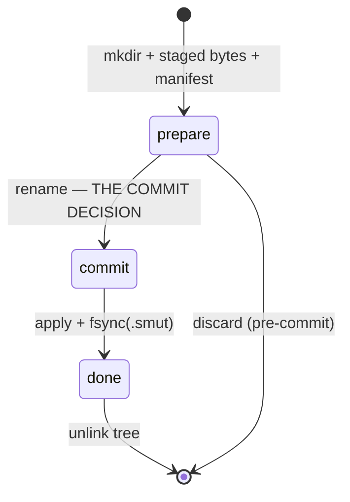
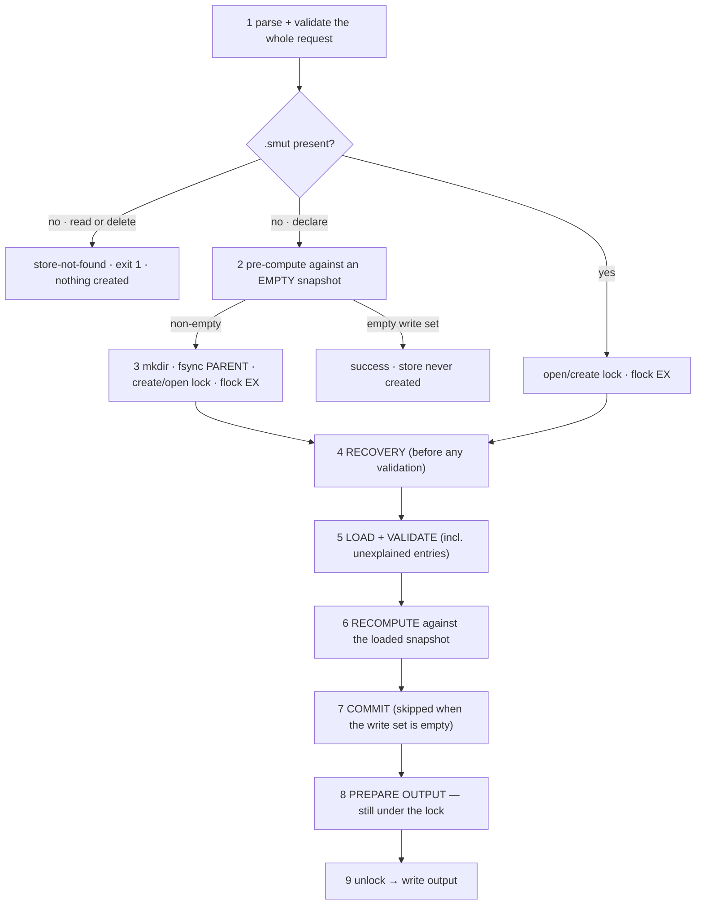

<!-- doctrine:section sec-1 -->
## 1. Design problem

`smut` is a notebook for an agent in the middle of a conversation. The agent
emits a batch of linked thoughts as JSON, revises them later, and reads them back
as Markdown — with little more effort than writing prose. This slice delivers the
first release of that tool: **write linked thoughts, read them back, and never
lose a batch.**

The boundary is deliberate and narrow. In scope: the entity and declaration
model, patch semantics, the on-disk store with its commit protocol and lock,
entity selection with ordering and a result limit, the Markdown projection, the
CLI, and an embedded agent guide. Out of scope, deferred to later releases with
their own design runs: the predicate language and graph traversal (IMP-001), and
the Mermaid renderer with its hardening and documentation tail (IMP-002).

### Current state

The repository is scaffolding: `Cargo.toml` with no dependencies, a
`src/main.rs` printing `Hello, world!`, a Nix devshell, and a `justfile` whose
targets are placeholders. There is no code to preserve, no schema to migrate, no
legacy behaviour to match. That is the licence this design takes for itself: it
is a from-scratch build, and the only obligations are the brief's observable
semantics.

### Forces and constraints

- **The brief is the whole canon.** No specification, ADR, policy or standard
  exists in this repository, so every load-bearing mechanism has to be justified
  in prose that a later reader can consult. That is why the eleven decisions
  underpinning this design are recorded as entities (DEC-001 … DEC-011) and cited
  from here rather than restated.
- **The brief fixes behaviour and delegates mechanism.** Envelopes, defaults,
  exit codes and the durability obligation are not negotiable; crate choice,
  module layout, the journal protocol and the comparator are ours.
- **Single user, single host, local filesystem, Linux primary.** No server, no
  authentication, no concurrency beyond two agent processes poking the same
  directory.
- **No coupling to the larger Doctrine project.** No governance concepts, no
  schemas, no trust enforcement, no reusable library API.
- **The store is small.** Whole-store scans are acceptable; the brief says so
  explicitly and refuses to pretend there is a hard total-work bound.

<!-- doctrine:section sec-2 -->
## 2. System model

One process, one store, one lock. The system has exactly two kinds of component,
and the split between them is the load-bearing structure of the whole design
(DEC-001):

- the **pure core** — functions over an in-memory snapshot of entities, which
  never see a uid, a path, the clock, entropy, a file descriptor or stdout;
- the **imperative shell** — argv, stdin, the lock, the journal, fsync,
  filesystem validation, exit codes.

```mermaid
flowchart TB
  subgraph shell["imperative shell"]
    argv["argv / stdin"] --> strict["strict JSON parse"]
    lock[("lock (permanent inode)"))]
    fs["store: load · validate · commit"]
    jr[("journal.prepare → commit → done")]
    fs --- jr
    lock --- fs
  end
  subgraph core["pure core — no uid, path, clock, entropy, fd"]
    norm["declare: normalize → fold → apply"]
    sel["select: roots → order → limit"]
    proj["project · envelope"]
    md["render markdown"]
    norm --> proj
    sel --> proj
    sel --> md
  end
  strict --> norm
  strict --> sel
  fs -->|"&Entities snapshot"| norm
  fs -->|"&Entities snapshot"| sel
  norm -->|"WriteSet (public ids)"| fs
  proj --> out["stdout"]
  md --> out
```

The core cannot express a storage failure — its only error type is `Reject`,
which is user error and always exit 2. The shell never interprets patch,
relationship or query semantics; it validates structure and identity, and commits
a content-blind write set. The consequence that matters for testing is that the
core's tests need no filesystem and the shell's interruption tests need no
declaration semantics.

### Module map

```
src/
  main.rs            entry: dispatch, error → exit code, emit
  cli.rs             clap definitions; input acquisition (arg / stdin / tty)
  input.rs           byte ingestion; strict duplicate-key JSON parse
  error.rs           Reject (exit 2) vs StoreError (exit 1)
  id.rs              Id newtype; IdSource; the reserved-id set for generation
  entity.rs          reference_id · scan_refs · extract · Entity serialisation wrapper
  declare.rs         normalize → fold → apply → Outcome { response, write_set }
  spec.rs            the 0.1 query-spec surface: parse and validate
  select.rs          roots · dedupe · order · limit · Selection · project · envelope
  order.rs           comparator: per-key missing-last, ID tiebreak
  numeric.rs         exact integer/float comparison (property tested)
  render_markdown.rs the Markdown projection
  learn.rs           embedded agent guide
  store/
    mod.rs           Store; the command pipeline
    index.rs         index.json read/write/validate
    journal.rs       prepare/commit/done state machine, replay, cleanup
    fs.rs            durable write helpers; reserved temporary names
    fault.rs         crash + fault injection seam, #[cfg(feature = "fault-injection")]
                     — absent from a release build, not inert inside one
docs/store-format.md
README.md
```

`declare.rs` is deliberately one module rather than three: normalisation, the
conflict fold and patch application are one semantic unit — what a declaration
request means — and splitting them would move data across boundaries without
buying separation.

`entity.rs` owns the *only* definition of a reference. 0.2's traversal will be
built on `reference_id` and `scan_refs`, which is what keeps the future query
language from growing a second, divergent notion of an edge (DEC-005).

<!-- doctrine:section sec-3 -->
## 3. Declaration semantics

A declaration request is normalised in full, folded into one operation per
top-level field, applied against the pre-batch snapshot, and only then written.
Nothing is written if anything is rejected.

### 3.1 What an object means

For every JSON object encountered, recursively (DEC-005):

- an object with a member `id` whose value is a nonempty string is an **entity
  node**;
- entity node with `id` and nothing else → a **reference**;
- entity node with `id` plus any other field → a **declaration**: it is hoisted
  to top level and its occurrence is replaced by an id-only reference.

`id` present but not a nonempty string (including `null`) is rejection, not an
instruction to generate. Generation applies only to *top-level* objects that lack
`id` entirely; a nested object without `id` is an embedded value and is never
given one.

Normalisation is a single recursive pass over finite JSON — each occurrence is
visited once. Hoisted entities' fields are visited by the same pass, so nesting
inside a hoisted entity behaves identically. Declarations are recorded in
**preorder**: a parent before the declarations it contains.

```json
{"id":"a","refs":[{"id":"b","note":{"id":"c","body":"x"}}]}
```

yields three declarations, in the order `a, b, c`: `a` with
`refs: [{"id":"b"}]`, `b` with `note: {"id":"c"}`, and `c` with `body: "x"`.

### 3.2 The operation fold

Normalisation yields one operation per declared entity per top-level field:
`Set(normalized_value)` or `Drop`. Two operations on the same field fold as
(DEC-002):

| left | right | result |
| --- | --- | --- |
| `Set(v)` | `Set(v)` equal | coalesce |
| `Set(v)` | `Set(v′)` unequal | reject the whole batch |
| `Set(v)` | `Drop` | reject the whole batch |
| `Drop` | `Set(v)` | reject the whole batch |
| `Drop` | `Drop` | coalesce |
| — | `Drop` | no-op |
| — | `Set(v)` | assign |

The granularity is the field, not the entity: disjoint fields of one id combine,
which is what makes repeated patches in a batch useful. Comparison is against the
**normalised** value, which is why the whole request is normalised first.

Equality is `serde_json::Value` structural equality with no coercion. Objects
ignore key order (the map is `BTreeMap`-backed, so `preserve_order` is off);
arrays are ordered; `null` is an ordinary value and conflicts with `Drop`;
`1` and `1.0` are **distinct**, so assigning both to one field is a conflict.
Duplicate keys inside one input object never reach this algebra: they are
rejected during parsing.

`"DROP"` is a sentinel only as a top-level entity field value — inside embedded
values and arrays it is ordinary data. The consequence, documented for users, is
that a top-level field cannot be assigned the literal string `"DROP"` in 0.1.

### 3.3 Statuses and the response

An existing explicit id with only `Drop` fields can create an id-only entity if
it did not exist; a bare id-only object never creates anything. `Drop` of an
absent field is a no-op and does not make an entity `updated`. `unchanged` means
the normalised patch leaves the entity structurally equal.

`previous` is captured once per affected entity from the pre-batch snapshot: the
full entity for `updated`, `null` for `created`, omitted for `unchanged`, omitted
everywhere under `--compact`. `ids` echoes the top-level input order including
repeats; `changes` holds each declared entity once in first-encounter order.
`missing` lists unresolved references — top-level id-only requests and nested
references alike — against the **post-batch** id set, unique and in encounter
order. It never audits untouched stored content, and it never rejects a batch.

Because object keys are canonically ordered (DEC-002), "encounter order" is
positional through arrays and lexical through objects. That is a deliberate,
documented choice: the store's bytes and the response's order are canonical
rather than textual.

### 3.4 Generated identifiers

Generated ids avoid existing entity ids in the snapshot, every explicit id
anywhere in the request (including forward references), and every other id
generated for the same batch (DEC-001). The core pre-scans explicit ids, then
draws candidates until one is unseen; the shell separately guarantees uid
uniqueness against the filesystem. This makes `normalize` *deterministic with a
supplied id source* rather than strictly pure — the concession that keeps tests
reproducible without an ambient RNG.

<!-- doctrine:section sec-4 -->
## 4. Store: format and commit

### 4.1 Layout

```
.smut/
  lock                  permanent lock inode; created once, never replaced
  index.json            committed index
  <uid>.json            one file per entity, holding the complete entity
  journal.prepare/      transient: staged bytes, commitment unknown
  journal.commit/       transient: committed, not yet applied
  journal.done/         transient: applied, being cleared
```

The index maps public ids to file basenames and is versioned:

```json
{"format_version":1,"objects":{"smut":"Ab3xK…json"}}
```

Internal uids are generated, filesystem-safe, independent of public ids, and
stable until deletion. Basenames are validated for safety on read and write: no
separators, no `.` or `..`, no symlink escape, no reserved names, no `.tmp`
suffix. Reserved names are `lock`, `index.json`, `manifest.json`, the three
journal directory names, and anything ending in `.tmp`.

An entity file holds the **complete** entity including its public id. `select`
never narrows what is persisted.

### 4.2 Canonical serialisation

One entity ordering, applied at the final serialisation boundary through a shared
wrapper (DEC-007): the entity root puts `id` first and its remaining keys
lexical; embedded ordinary objects are all-lexical; arrays keep their order.

Two byte forms, deliberately different:

| surface | form |
| --- | --- |
| entity files, `index.json`, journal manifest | pretty-printed, 2-space indent, trailing newline |
| command stdout | compact single line, trailing newline |

Serialising and then re-parsing to arrange keys is never done: `Value` erases any
ordering a wrapper imposed upstream.

### 4.3 The commit protocol

The **state is a directory name** (DEC-003). Under the lock, at most one of the
three journal directories exists, and each rename is a transition.



`journal.prepare/` holds the new bytes for every touched file, staged under its
final basename, plus `manifest.json` naming the write set:

```json
{"format_version":1,"puts":["index.json","Ab3xK….json"],"removes":["Zq7pR….json"]}
```

The manifest **is** the write set and the staged directory is its materialisation;
disagreement between them is corruption, never something to infer around.

**Every commit stages a fresh `index.json`**, including a batch that only
updates existing entities and changes no id-to-file mapping. The write set is
therefore always the same shape, the crash suites assert one shape rather than
two, and the protocol never has an optional member whose absence means
"unchanged".

**The commit decision is not the same as its durability.**

| point | logical status | recovery finds |
| --- | --- | --- |
| before the rename | nothing published | `prepare` — discard; the store is exactly as it was |
| rename done, parent fsync not yet successful | **uncertain after power loss** | `prepare` or `commit`; both are coherent |
| parent fsync successful | durable commitment | `commit` — must roll forward |

Applying never begins before that parent fsync succeeds. Symmetrically,
`.smut/` is fsynced after the `commit → done` rename *before* any journal content
is deleted, or power loss could restore the `commit` name after its replay
material is gone.

Within a commit the order is **puts → index → removals**, so the committed index
never names a file that does not exist. This is a convenience for humans reading
the directory, not a guarantee to unlocked observers: an external reader can
still read the old index, pause, and find a file gone.

### 4.4 Recovery

Recovery runs under the lock and strictly before store validation — the ordering
that keeps a crashed store recoverable instead of refused.

1. Refuse without modifying evidence if more than one journal directory exists.
2. Remove only protocol-owned temporaries (the narrow reserved namespace), never
   arbitrary `*.tmp` files.
3. `done` → finish cleanup. `prepare` → discard. `commit` → validate the manifest
   completely (format version, safe and unique basenames, `puts` and `removes`
   disjoint, reserved names excluded, every listed put present, every staged file
   listed), then replay, then rename to `done`, fsync, and clear.

Replay is a total re-execution: each staged file is written to `<name>.tmp`,
fsynced, and renamed over its target; each removal is unlinked again. Nothing is
inferred from what is missing, so there is no silent-repair path at all. Nothing
in recovery or cleanup resolves a symlink.

A crash between writing `<name>.tmp` and renaming it leaves a temporary outside
the journal; recovery removes it before validation, so the strict
unexpected-entry rule cannot turn a recoverable crash into an unrecoverable one.

### 4.5 Failure after commitment

If apply fails (ENOSPC, EIO) the commit decision stands: exit 1, leave
`journal.commit/` in place, and let the next command complete it. Rolling back a
committed batch because the disk filled would be a worse lie than failing
forward.

### 4.6 What the format document will claim

> Under the documented filesystem and fsync assumptions, cooperating commands
> observe whole batches. Before application begins, the commit decision is made
> durable. Interrupted committed batches are replayed before any command serves
> store state. Failure before acknowledgement may leave the outcome uncertain;
> successfully acknowledged batches are durable.

That is **atomic visibility through locking and recovery** on top of non-atomic
physical publication. It is not claimed that a group of renames is atomic on any
real filesystem, and the ambiguity is named precisely: a write may have committed
with no success response received. The uncertain case is *commit before
acknowledgement*, never after it.

### 4.7 Format versioning

`format_version` appears in both the index and the manifest. An unknown version is
exit 1. There is no migration path in 0.1, and no repair path at any point: a
malformed index, a missing indexed file, a duplicate path mapping, an id/content
disagreement, or an unexplained entry in `.smut/` are all explicit inconsistency
errors. Unindexed files are never adopted.

<!-- doctrine:section sec-5 -->
## 5. Command pipeline

Every command that observes or mutates store state takes one **exclusive** lock
on `.smut/lock` — reads included, because a read may recover, which mutates
(DEC-004). `learn`, `--help` and `--version` touch neither lock nor store.



**Only `declare` ever creates a store.** In a directory with no `.smut/`, a read
or a delete is store-not-found: exit 1, nothing created, and no `missing` list
invented for ids that were never stored. `get`, `query` and `render` are subject
to this exactly as `delete` is.

Steps 1, 2 and 6 exist for specific reasons:

- **1** means a malformed spec, an invalid flag combination or bad JSON never
  creates, locks or recovers a store. Validation is of the *whole request*, not
  just the JSON text.
- **2** means a declaration that cannot produce a write leaves the filesystem
  untouched — including one that is entirely references.
- **6** exists because step 2 ran against an empty snapshot. The lock may have
  been won by a process that created the store and committed a first batch
  meanwhile, so the recomputation is the authoritative one.

### 5.1 Initialisation

A new store gets `mkdir .smut` and a lock file. **No index is written at
initialisation**: the first `declare`'s commit stages and publishes `index.json`
through the ordinary protocol, so exactly one code path ever creates an index.

`mkdir` returning `AlreadyExists` is normal — the loser joins the locking path.
The lock file is opened or created without truncation and is never replaced,
renamed or unlinked: replacing or unlinking it forks the lock domain, and
truncating it changes nothing while destroying nothing, so it is simply avoided.

Creating `.smut` requires fsyncing its **parent directory** to claim survival of
power loss, and any process using a possibly newly created store syncs that
parent entry itself before acknowledging a write. It does not depend on the
process that won `mkdir` surviving long enough to do so.

### 5.2 Validation, including what the index does not explain

Validation covers the index and mapped files — known format version, parseable
JSON, safe basenames, mapped files present, no duplicate path mappings, each
file's `id` equal to its index key — and equally the entries the index does not
explain. An unexpected entry in `.smut/` outside the reserved names and the
journal directories is the same explicit inconsistency error, naming the entry.

An unexplained entity file must not silently disappear from the graph, and a
permissive rule here is how silent loss begins. The namespace is reserved by the
tool.

An index-less `.smut/` containing anything beyond `lock` and journal directories
is refused rather than treated as a fresh store: a lost index beside intact
entity files must not read as "start over", because initialising would orphan
every thought in it.

### 5.3 Output

Output is serialised in full **before** unlocking and written afterwards. That
keeps rendering errors separate from pipe failures and guarantees the response
describes the snapshot actually processed. A stdout failure after a commit cannot
undo the commit; that ambiguity is documented, not engineered around.

### 5.4 Concurrency scenarios under test

Two simultaneous first declarations against a store that does not yet exist;
termination before the first lock acquisition; and a second process recovering
the first process's transaction before running its own command. The invariants
are that a store is created at most once, no batch is partially visible, and no
process observes an unrecovered journal.

<!-- doctrine:section sec-6 -->
## 6. Selection and projection

Selection is the same pipeline for `query` and `get`; `get` is selection with an
explicit `from`, no limit and no `select` (DEC-001, DEC-007).

**Roots → order → limit → project.**

Roots come from `from` in its own array order, or — absent — every id in ID
order; dedupe keeps the first occurrence. `from` order is *discovery* order only:
supplying `order` replaces it wholesale, and `order: []` is equivalent to
omitting it. Missing roots are excluded from results, reported in `missing` in
`from` order, unique, and never consume `limit`.

### 6.1 The comparator

Per key, in array order (DEC-006):

| situation | outcome |
| --- | --- |
| both missing | continue to the next key |
| exactly one missing | that record sorts later, regardless of direction |
| both present | compare values; apply direction only to a non-equal result |

All keys tying breaks on **ID ascending**, so the result is a total order
independent of sort stability. Missing-last is per key, never a final partition:
two records missing `priority` must still be ordered by `title`. Every candidate
sort value is validated before sorting begins, so an array or object in an order
field rejects reliably even with a single candidate.

Scalar type order is `null` < `false` < `true` < number < string. `null` is a
value that sorts first, not an absence. Strings compare by UTF-8 bytes — codepoint
order, no collation, no locale, no normalisation. `id` is an ordinary top-level
field and may be named in `order`.

Numbers compare **exactly against the value each actually represents**
(`numeric.rs`), decomposing the float rather than rounding the integer. The
rejected alternative — integers exact, mixed pairs as `f64` — is not merely
imprecise but *cyclic*: with integers `9007199254740992` and `9007199254740993`
and float `9007199254740992.0`, it yields `z < a`, `a < m`, `m < z`. A comparator
that can cycle is not a comparator. `numeric.rs` carries property tests for
totality and transitivity over ±2⁵³, i64/u64 extremes, subnormals and signed
zeros.

A documented asymmetry follows: `1` and `1.0` are unequal for structural equality
but compare equal for ordering, and `0`, `0.0` and `-0.0` compare equal with ties
broken by ID.

### 6.2 Truncation

`limit` is a positive integer (0 rejected), default 100, applied after ordering.
`truncated: true` and `truncation_reasons: ["result_limit"]` appear only when rows
were actually omitted; a result of exactly `limit` rows is not truncated. `get`
never truncates. The Markdown renderer reports omission without a row count,
because the selection does not retain a pre-limit count and is not widened for
one (DEC-009).

### 6.3 The selection and the envelope

```rust
struct Selection<'a> {
    ids:     Vec<&'a Id>,           // ordered, deduped, post-limit
    store:   &'a Entities,          // full entities, for projection and rendering
    fields:  Option<&'a [String]>,  // `select`; None = all
    missing: Vec<&'a Id>,           // explicit roots absent
    truncated: bool,
    reasons: Vec<Reason>,
}

fn project(&Selection<'_>) -> Vec<Value>;   // owned, field-filtered
fn envelope(&Selection<'_>) -> Value;       // pure; the shell only prints it
```

`envelope` lives in the core, so query/get tests need no filesystem. Envelope
rules:

- `id` in every object regardless of `select`; `select: []` yields `id` only.
- Selected fields absent from an entity are omitted, not `null`; selection
  addresses top-level fields only.
- `objects` is flat — referenced entities are never inlined.
- `missing`, `dangling`, `truncated` and `truncation_reasons` are always present,
  even when empty or false. `dangling` is structurally `[]` in 0.1, kept so the
  envelope shape does not change in 0.2.
- `select` duplicates behave as a set; naming `id` is a no-op; naming an unused
  field is not an error. The `select` set never determines JSON key order.

**The store reference is not permission to widen the result.** Renderers consume
`Selection` and render only `ids`; 0.2's Mermaid output will include an edge only
when both endpoints are selected. Holding the whole store must never let a
renderer bypass `limit`.

<!-- doctrine:section sec-10 -->
## 10. Risks and mitigations

| risk | mitigation |
| --- | --- |
| `flock` is advisory, so an editor or `cat >` can corrupt the store | Documented as unsupported; the README states that nothing is promised to a process that does not take the lock. `flock` is also unreliable on some network filesystems — stated in the portability note rather than solved |
| Process-abort tests prove replay and cleanup, not power-loss write ordering | Stated explicitly wherever the guarantee is claimed; fsync obligations are documented per step, and the tests claim only what they measure. Simulating filesystem failure is out of scope for 0.1 and named as such |
| The numeric comparator is subtle enough to be silently wrong | Exact comparison in one small module; property tests for totality and transitivity over ±2⁵³, i64/u64 extremes, subnormals and signed zeros; the cyclic alternative is recorded so nobody reintroduces it |
| Crash injection could leak into production builds | Gated behind a test-only cargo feature, not an environment variable in ordinary builds |
| The `normalize → write-set → commit → reload` seam is untested by either side's unit tests | A small dedicated integration suite owns that seam; it is the one place where "all units pass" can still mean a broken system |
| Concurrency tests are flaky by nature | Tests assert invariants — created at most once, no partial batch visible, no unrecovered journal — with bounded retries rather than interleavings |
| The query language could grow during 0.2 | Out of this slice by construction; IMP-001 names the deferred questions so they are designed there rather than accreting here |
| Beta toolchain drift | Pinned in the flake; edition 2024 is already in `Cargo.toml` |

The risk this design spends most of its mechanism on is the one with no cheap
later fix: a crash mid-batch leaving a store that *looks* coherent while some
entity updates are silently missing.

<!-- doctrine:section sec-11 -->
## 11. Quality engineering and validation

The boundary from DEC-001 is what makes this testable: the core's tests need no
filesystem, and the shell's interruption tests need no declaration semantics. Each
layer below exists because some failure is invisible to the others.

### 11.1 Layers

| layer | where | proves |
| --- | --- | --- |
| core unit | `src/**` `#[cfg(test)]`, no fs | declaration algebra, hoisting and preorder, equality and conflict, ordering, projection, envelope, Markdown layout and encoding, spec validation |
| property | `numeric.rs`, `declare.rs` | numeric comparator **totality and transitivity**; the fold is idempotent and coalescing; normalisation is deterministic for a given id source |
| integration | `tests/**` spawning the binary via `CARGO_BIN_EXE_smut` | exit codes, stdout/stderr separation, stdin and `-`, `--`, the TTY heuristic, full command envelopes |
| durability | `tests/durability_crash.rs`, test-feature-gated injection | interruption at every named boundary, replay, cleanup, and recovery of an already-interrupted recovery; plus injected short writes, failed fsync, failed rename and failed unlink |
| concurrency | `tests/concurrency.rs` | two simultaneous first declarations, termination before the first lock acquisition, and one process recovering another's transaction |
| corruption | `tests/store_corruption.rs` | malformed index or entity, missing indexed file, duplicate path mapping, id/content disagreement, unexplained entry, unknown format version, two journal directories, symlink escape |
| compatibility | `tests/compatibility.rs` | representative 0.1 invocations keep working when the spec surface widens in 0.2 |

Crash injection lives behind a **test-only cargo feature**, not an
environment-triggered abort compiled into ordinary builds. The suite claims only
what it measures: that replay and cleanup are correct after process interruption,
not that write ordering survives power loss.

### 11.2 The seam that unit tests miss

`normalize → write-set translation → commit → reload` is the one path neither half
tests alone: the core produces a write set the shell translates, and only a
round-trip proves the entities survive it. `tests/roundtrip.rs` owns it, and it is
deliberately small.

### 11.3 Coverage against the brief's mandate

Every item the brief requires is owned by a layer above: single/array
declarations, generated ids, forward and nested references, embedded values and
id-only missing references (core unit); omitted fields, `null`, `DROP`,
wholesale replacement and nested declarations inside replacements (core unit);
duplicate ids and assignments, duplicate JSON keys, batch rejection without
partial mutation, complete pre-batch `previous` values (core unit + integration);
filename/public-id separation, escaping paths, malformed index and entity data,
absent-store behaviour (corruption + integration); concurrent processes and
injected interruption at every journal boundary (durability + concurrency);
missing/`null` semantics, ordering, invalid queries (core unit); get ordering,
non-cascading delete, render escaping and visible incompleteness (integration +
core unit); the end-to-end workflow with stdin and stdout/stderr separation
(integration).

### 11.4 Gates

`cargo fmt --check`, `cargo clippy -- -D warnings`, and `cargo test` — wired as
real `justfile` targets so "run the checks" is one word. The `justfile` currently
holds placeholders; this slice replaces them.

<!-- doctrine:section sec-12 -->
## 12. Code impact

All paths are new except where noted. The `justfile` and `Cargo.toml` carry the
only edits to existing files.

| path | change |
| --- | --- |
| `Cargo.toml` | dependencies `serde`, `serde_json`, `nanoid`, `fs4`, `clap`; dev-dependency `proptest`; a test-only `fault-injection` feature |
| `src/main.rs` | replace the placeholder: dispatch, error → exit code, emit |
| `src/cli.rs` | clap definitions; input acquisition; flag validation |
| `src/input.rs` | byte ingestion and the strict duplicate-key JSON visit |
| `src/error.rs` | `Reject` (exit 2) and `StoreError` (exit 1), and the mapping |
| `src/id.rs` | `Id`; `IdSource`; the reserved-id set used during generation |
| `src/entity.rs` | `reference_id`, `scan_refs`, `extract`, the `Entity` serialisation wrapper |
| `src/declare.rs` | normalise → fold → apply → `Outcome { response, write_set }` |
| `src/spec.rs` | the 0.1 spec surface: parse, type-check, named-future versus unknown keys |
| `src/select.rs` | roots, dedupe, order, limit, `Selection`, `project`, `envelope` |
| `src/order.rs` | the per-key missing-last comparator with the ID tiebreak |
| `src/numeric.rs` | exact integer/float comparison |
| `src/render_markdown.rs` | the Markdown projection, label escaping, id fencing, diagnostics |
| `src/learn.rs` | the embedded guide |
| `src/store/mod.rs` | `Store` and the command pipeline |
| `src/store/index.rs` | read, write and validate the index |
| `src/store/journal.rs` | the prepare/commit/done state machine, replay, cleanup |
| `src/store/fs.rs` | durable write helpers and the reserved temporary namespace |
| `src/store/fault.rs` | the feature-gated crash and fault injection seam |
| `tests/roundtrip.rs`, `tests/durability_crash.rs`, `tests/concurrency.rs`, `tests/store_corruption.rs`, `tests/cli_contract.rs`, `tests/selection.rs`, `tests/render.rs`, `tests/compatibility.rs` | the layers in §11 |
| `README.md` | new: worked example, command table, sharp edges, the guarantee quoted from DEC-003, portability note |
| `docs/store-format.md` | new: `format_version` 1, layout, serialisation, journal states and fsync obligations, recovery, reserved names, corruption responses |
| `justfile` | replace placeholders with `build`, `test`, `lint`, `fmt`, `check` |

**Design-target selectors** committed by this section: `src/**`, `tests/**`,
`docs/**`, `README.md`, `Cargo.toml`, `justfile`.

`proptest` is the one dependency this design adds beyond the five settled during
research, and it is a dev-dependency only: the numeric comparator and the fold
algebra are exactly the kind of code where an example-based test proves the cases
you thought of and nothing else.

<!-- doctrine:section sec-7 -->
## 7. Presentation: Markdown, CLI and the spec surface

Presentation is a projection of the same `Selection` the JSON envelope comes
from; nothing is recomputed and nothing is fetched twice.

### 7.1 Markdown

Entities in selection order, separated by one blank line (DEC-009):

```
## Query design

Keep selection small.

- **type:** question
- **tags:** ["storage"]
```

- **Heading**: `#`×level + the heading field's value, only when that field is
  selected, is a string, and is non-empty. Defaults: field `title`, level 2.
  Newlines inside heading text collapse to spaces — structural, not escaping.
- **Body**: when `body` is selected and is a string, emitted verbatim as its own
  block. Body bytes are never trimmed or escaped; Markdown content is preserved
  and never executed.
- **Other fields appear only with `--show-fields`**, as `- **name:** value` —
  strings raw, everything else compact JSON. The heading field and `body` are
  excluded from that list only when they were *actually* rendered specially, so a
  non-string `body` stays displayable as JSON.
- `--heading-field body` renders that value once: as the heading, not again as a
  body block.
- **Fallback**: when nothing else would be *visible*, identity is rendered instead
  so a bodyless entity never silently vanishes. An empty or whitespace-only body
  does not count as visible and cannot suppress the fallback.
- **Encoding**: generated field labels are escaped, and ids are delimited safely —
  a fence longer than the longest backtick run inside the id, padded when the id
  begins or ends with a backtick. A fixed single-backtick span is insufficient
  because public ids are opaque. Ids are never joined ambiguously with commas.
- **Separators do not trim body bytes.** A body ending in newlines may produce
  extra blank lines between entities; verbatim fidelity wins over uniform spacing.
- **Diagnostics belong in the document**, after a blank line, never only on
  stderr: `> truncated: result_limit; additional entities omitted` and
  `> missing: `a`, `b``. There is no `N of M shown` form — that needs a pre-limit
  count the selection deliberately does not retain.

`--format markdown` is the default and the only value in 0.1; `mermaid` is
refused with exit 2 and the message *"not supported in 0.1; planned for 1.0"*,
supplemented by the tracking item. User-facing copy names a release, never a bare
item id.

### 7.2 CLI

`clap` v4 derive; its usage exit code is 2, matching the brief without
special-casing (DEC-008).

```
smut declare [JSON] [--compact]
smut query   [JSON]
smut render  [JSON] [--format markdown] [--heading-field <name>] [--heading-level <1-6>]
                    [--show-ids] [--show-fields]
smut get    <ID>...
smut delete <ID>...
smut learn
```

Exactly one JSON operand; `-` reads stdin explicitly. Operand absent: on a TTY →
usage help and exit 2; on a pipe → read stdin. Trailing non-whitespace after the
JSON value is exit 2, and there is no newline-delimited stream mode. **`--`
terminates flags**, so an opaque id beginning with `-` is reachable
(`smut get -- -weird-id`). Duplicate JSON keys are rejected during parsing, before
any store access.

Exit codes: `Reject` (invalid input, malformed spec, bad flag combination) → 2;
`StoreError` (absent store, corruption, IO) → 1; success including reported
missing ids and truncation → 0.

### 7.3 Spec surface

Accepted keys are `from`, `select`, `order`, `limit` (DEC-011). `query {}` returns
all entities subject to the default limit — not a list of ids. A non-object spec
is exit 2.

Recognised future keys are rejected **by name, with the release that will accept
them** (`where`, `follow`, `backlinks`, `depth`, `budget` → 0.2). Arbitrary
unknown keys are reported plainly as unknown: naming a release for a key nobody
planned would be a guess presented as a promise.

Rejection keeps the *syntax* additive — a working 0.1 call cannot become invalid
when the key set widens — but it does not guarantee unchanged behaviour, so
representative 0.1 invocations are kept as compatibility tests.

<!-- doctrine:section sec-8 -->
## 8. Invariants, assumptions and edge cases

### 8.1 Invariants the implementation must preserve

1. The core cannot express a storage failure; every `Reject` is exit 2.
2. The shell never interprets patch, relationship or query semantics.
3. Exactly one code path creates `index.json`.
4. Recovery strictly precedes validation, every time, under the lock.
5. The lock file is never replaced, renamed or unlinked.
6. A generated id never collides with an existing, explicit or previously
   generated id — a generated collision can never become an upsert.
7. Batch rejection writes nothing and reports no `previous` values.
8. `select` hides fields from output but never from the store or from projection's
   inputs.
9. Only `ids` are rendered; store access never widens a result past `limit`.
10. Entity serialisation happens at the byte boundary, through one wrapper.

### 8.2 Assumptions

- Single user, single host, local filesystem with working `flock` and `fsync`;
  Linux is the acceptance platform.
- The store fits comfortably in memory, so whole-store scans are acceptable.
- Public ids are user-chosen and stable; internal uids never appear in output.
- Stored content is data, not instruction; no trust enforcement is added.
- A beta toolchain is acceptable for development; no MSRV promise in 0.1.

### 8.3 Edge cases, resolved

| case | behaviour |
| --- | --- |
| `{"id": null}` | rejection, exit 2 — not a request to generate |
| nested object without `id` | embedded value, never given an id |
| `{"id":"x","status":"DROP"}` on absent `x` | creates an id-only entity |
| bare `{"id":"x"}` on absent `x` | reference only; no creation; reported in `missing` |
| `DROP` of an absent field | no-op; status not `updated` |
| same id declared twice, disjoint fields | both applied |
| same id declared twice, conflicting fields | whole batch rejected |
| `1` then `1.0` in one batch, same field | conflict — rejected (distinct values) |
| body is whitespace only | not visible; ID fallback rendered |
| id containing backticks | safely fenced code span in Markdown |
| `order` names a field absent from every entity | all tie; ID order |
| `limit` exactly equal to the result count | not truncated |
| `from: []` | selects nothing; no error |
| empty declaration | success; store not created |
| absent store, read or delete | exit 1; nothing created |
| index lost, entity files intact | refused as corrupt; never initialised over |
| crash after commit, before output | may have committed; next command replays |
| apply fails after commit | exit 1; journal left for the next command |

<!-- doctrine:section sec-9 -->
## 9. Decisions index

Each decision is an entity in this repository; this section is an index, not a
restatement.

| decision | settles |
| --- | --- |
| DEC-001 | The core/shell boundary: pure functions over an id-keyed snapshot, write sets in public-ID space, total `Reject`, deterministic-with-supplied-ID-source generation, borrowing selection |
| DEC-002 | Declaration equality: per-field `Set`/`Drop` fold, structural JSON equality, numbers distinct, canonical key order |
| DEC-003 | Journal: state-as-directory-name, the commit decision and its durability as separate concerns, state-dependent validation, protocol-owned temporaries, atomic visibility |
| DEC-004 | Pipeline: one exclusive lock on a permanent inode, recovery before validation, two-phase initialisation, unexplained entries as inconsistency, output prepared under the lock |
| DEC-005 | References: one predicate, hoisting, label on the containing entity, preorder recording, request-error versus stored-corruption split |
| DEC-006 | Ordering: per-key missing-last, exact numeric comparison, ID tiebreak, `result_limit` only on real omission |
| DEC-007 | Projection and envelope: borrowing selection, final-boundary serialisation, id-first canonical form, flat non-inlined output |
| DEC-008 | CLI: clap grammar, `--` for opaque ids, whole-request validation before store access, `--format` refusal naming a release |
| DEC-009 | Markdown: fields only on request, safe delimiters, fallback on visibility, in-document diagnostics, no pre-limit count |
| DEC-010 | Documentation set: README, versioned store format, `learn`; commit-before-acknowledgement ambiguity |
| DEC-011 | Spec surface: four keys, named future keys, plain unknown keys, compatibility protected by tests |

The alternatives considered are recorded on each decision rather than collected
here, because an alternative only means something relative to the choice it lost
to.

