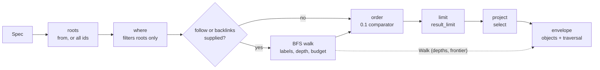

<!-- doctrine:section sec-1 -->
## 1. Design problem

`smut` 0.1 answers "read these named entities back". It cannot answer "which open
questions hang off this session?" without dumping the whole store and filtering
by hand — which is exactly how the operator used it in the first live session.
This slice delivers the brief's **Query contract**: a closed predicate language
over roots, deterministic bounded traversal in both directions, and a result
that carries enough provenance for a client not to reconstruct what the walk
knew.

The boundary is the brief's, not an invention:

- **In:** `where` with the five field operators and three boolean clauses;
  `follow`, `backlinks`, `depth`, `budget`; the six determinism rules; `dangling`
  reporting; `traversal_budget`; the widened grammar; and the first-use store as
  the acceptance fixture.
- **Out:** Mermaid and the presentation tail (IMP-002), the 0.1.x chronology and
  legibility fixes (IMP-003), a validating schema, modelled containment, an
  in-store audit, nested-field predicates, pipelines, pagination, secondary
  indexes and first-class edge types.

`where` stays **roots-only**. The two-call composition — traverse for ids, then
filter those ids as roots — is the idiomatic answer, and the guide is where it
lives (DEC-016). Adding a filter to traversal would move the release from "the
brief's query contract" to "a query language", which the brief names as the
likely site of scope creep.

Two things make this release cheaper than it looks. The reference definition
already exists: `entity::scan_refs` returns `(label, target)` pairs, labels the
originating top-level field, and stops at a reference occurrence (`src/entity.rs:71`).
The walker consumes it rather than re-walking JSON. And the store's substrate is
ordered: `Entities` is a `BTreeMap<Id, Value>` (`src/declare.rs:26`), the index
is a `BTreeMap` (`src/store/index.rs:75`), and `serde_json::Map` is a `BTreeMap`
under the enabled features, so ID order and lexical field order are structural.
The order the code must impose is the one the brief actually asks for: named
fields in **query** order, outgoing before incoming, incoming sources by ID.

<!-- doctrine:section sec-10 -->
## 2. Current state and what 0.2 consumes

0.1 is complete and shipped (SL-001, head `1649741`; 0.1.1 published). 0.2 does
not reopen its mechanisms; it extends four seams.

| 0.1 mechanism | Where | What 0.2 does |
| --- | --- | --- |
| Query grammar: four keys, future keys refused by name | `src/spec.rs:26,70,86` | Retire the future-key refusal, add the five keys and their strict types |
| Pipeline: roots → order → limit → project | `src/select.rs:79` | Insert predicate filtering at roots and traversal between roots and order; add provenance to `Selection` |
| Reference definition | `src/entity.rs:31,71` | Consume `reference_id` / `scan_refs` unchanged; the walker is a client of them |
| Comparator: per-key missing-last, ID tiebreak, exact numbers | `src/order.rs:66` | Unchanged; traversal-discovered ids sort exactly like roots |
| Envelope: flat objects, `missing`, `dangling`, `truncated`, reasons | `src/select.rs` `envelope` | Add one conditional `traversal` member; `dangling` gains traversal content |
| Markdown completeness notice | `src/render_markdown.rs:280` | Disclose `traversal_budget` and dangling diagnostics in the same leading block |
| Guide | `src/learn.rs` (`GUIDE`) | Teach the 0.2 surface, the two-call idiom and its completeness guard; remove the 0.1 release notice |
| Compatibility pins | `tests/compatibility.rs:316` | Keep the 0.1 query pin; re-cut the `where`-refusal test into an additivity pin |
| Store format | `docs/store-format.md` | Unchanged; `format_version` stays 1 |

The first-use store is product evidence, not defect evidence: 66 entities, 44
distinct reference targets, 22 with nothing pointing at them — measured before
the privacy read-through of §11, so source evidence rather than a test assertion
(§13.1 pins the committed array) — labels `part-of`
(65), `about` (48), `answers` (5) and `projects` (1). It contains one superseded
finding retired in place, settled and open findings, and one mutually-referencing
pair — `finding-smut-17` ↔ `prop-conventions-library`; its five `type: cluster`
entities are one-directional, each naming the session. It contains no retracted
record at all: its own `vocab` says
`superseded` retired `finding-smut-16`, which is the conflation §9.2 now names.
It is the acceptance graph (DEC-018), with two caveats: its `vocab` entity says
`projects` is unused while `a-focus` uses it, and its status list collapses
retraction into supersession, so tests assert against entities, never against
the vocabulary prose.

<!-- doctrine:section sec-11 -->
## 3. Forces and constraints

- **The brief is the authority.** Every observable semantic — operators,
  defaults, determinism rules, envelope members, truncation reasons, exit codes
  — is fixed there. 0.2 may choose mechanism, not behaviour. Where the brief is
  silent (the shape of provenance, the wildcard spelling), this design records a
  decision rather than inventing a requirement.
- **Roots-only `where` is deliberate.** The cost is an idiom, not a defect
  (`finding-smut-18`). The composition must be taught, not engineered around.
- **Compatibility is a tested property.** `DEC-011` keeps a working 0.1 call
  valid, and `tests/compatibility.rs` pins the whole parsed 0.1 envelope,
  including its key set. Additive syntax is not enough; the response must not
  move (DEC-019).
- **One reference definition.** A second walker that interprets references
  differently produces the failure that is hardest to see: a traversal that
  silently misses an edge (`finding-smut-19`). The walker must consume
  `entity.rs`.
- **Permissiveness is the product.** No schema, no type enforcement, no
  referential integrity, no containment model, no audit mechanism. Conventions
  are printed advice, never checked (DEC-017).
- **Small store, whole-store scans.** Single user, single host, local
  filesystem, store fits in memory. `backlinks` is O(store) per hop and the
  budget does not bound it; the documentation says so rather than implying a
  total-work limit.
- **No new dependency.** Predicates are a closed interpreter over
  `serde_json::Value`; traversal is a BFS over `Entities`. A graph crate would
  be a parallel model of the thing the store already is.
- **Human-only review.** The design run's review policy is human-only; the
  operator reviews sections and accepts the lock.

Two operator caveats bind the draft: the fixture gets a fresh-agent privacy
read-through before it is committed (DEC-018), and the conventions library ships
one set with the second — the epistemic-records schema — deferred to `IMP-004`
rather than half-designed here (DEC-017).

<!-- doctrine:section sec-12 -->
## 4. System model and pipeline

One process, one store, one lock — unchanged from 0.1. The pure core gains two
new pure pieces: a predicate evaluator over an entity, and a walker over the
snapshot. Neither knows about files, uids, stdout or the clock.



The walker runs on **full entities**, before projection and after the roots are
filtered. That ordering is load-bearing twice: a `select` that hides a reference
field must not erase connectivity, and the result limit must not widen what a
renderer may draw.

**Module map**

| Module | Responsibility | Change |
| --- | --- | --- |
| `src/spec.rs` | Parse the query specification, validate the whole request | Five new keys; `Spec` grows; future-key refusal retires |
| `src/predicate.rs` (new) | Parse a `where` object into a predicate AST; evaluate one entity | New, pure |
| `src/walk.rs` (new) | Breadth-first walk over `Entities` consuming `entity::scan_refs`; `Walk`, `Dangling`, `Fields` | New, pure |
| `src/select.rs` | Pipeline: roots → where → walk → order → limit; `Selection`, `Reason`, `envelope` | Integrate; add `walk` and `TraversalBudget` |
| `src/entity.rs` | The single reference definition: `reference_id`, `scan_refs` | **Unchanged**; consumed by `walk` |
| `src/order.rs` | Comparator and ID tiebreak | **Unchanged** |
| `src/conventions.rs` (new) | The convention sets, listing, prose and seed declaration | New, pure text |
| `src/conventions/*.md` (new) | One embedded prose file per set | New content |
| `src/learn.rs` | The embedded guide | Rewrite the query and workflow sections |
| `src/cli.rs`, `src/main.rs` | Grammar, command routing, the `conventions` command | Add one command; no store access |
| `src/render_markdown.rs` | Markdown projection and the leading completeness notice | Add dangling and budget disclosure |
| `src/error.rs` | Every `Reject`, all exit 2 | New predicate/traversal refusals |
| `src/lib.rs` | Module exports | Two new modules |

The walker's contract is narrow:

```rust
pub fn walk<'a>(
    store: &'a Entities,
    roots: &[&'a Id],
    follow: Option<&Fields>,
    backlinks: Option<&Fields>,
    depth: u64,
    budget: u64,
) -> Walk<'a>;
```

`Walk` owns its order but borrows ids, labels and entities from the snapshot:

```rust
pub struct Walk<'a> {
    pub order:    Vec<&'a Id>,          // discovery order, deduped
    pub depths:   BTreeMap<&'a Id, u64>,
    pub frontier: Vec<&'a Id>,          // discovered, never expanded
    pub dangling: Vec<Dangling<'a>>,    // deduped triples
    pub exhausted: bool,                // budget declined a real expansion
}

pub struct Dangling<'a> { pub source: &'a Id, pub field: &'a str, pub target: &'a str }
```

The walk does not carry the edge set. Edges are a property of the **returned**
objects, not of the expansions that discovered them: the envelope derives the
induced subgraph from the full entities after the limit (§8.2), so a returned
node that was never expanded still contributes its edges.

`Selection` grows one field, `walk: Option<Walk<'a>>`, so the envelope and the
Markdown notice are pure functions of the selection. `get` never traverses and
therefore never carries a `Walk`.

<!-- doctrine:section sec-13 -->
## 5. Query specification grammar

`src/spec.rs` keeps its shape — one pass over the object's keys, whole request
validated before any store access — and accepts nine keys.

| Key | Accepted form | Default |
| --- | --- | --- |
| `from` | string or array of strings | absent = every id in ID order; `[]` = nothing |
| `where` | predicate object (§6) | absent = true |
| `follow` | `"*"` or array of top-level field names | absent = no outgoing traversal |
| `backlinks` | `"*"` or array of top-level field names | absent = no incoming traversal |
| `depth` | nonnegative integer | `1`; `0` is roots only |
| `select` | array of strings | all fields |
| `order` | array of `{field, direction?}` | discovery order |
| `limit` | positive integer | `100` |
| `budget` | positive integer | `10000` |

Rules:

- **Whole-request validation.** A malformed predicate, a bad depth, a negative
  or zero limit/budget, an unknown key or an unknown operator rejects with exit
  2 before the store is opened, locked or created. Step 1 of 0.1's pipeline is
  unchanged.
- **Unknown keys stay unknown.** `FUTURE_KEYS` retires; a key 0.2 does not know
  is reported plainly, not with a guessed release.
- **The wildcard has one spelling.** `"*"` as the whole value means every
  top-level field. An array must contain field names; an element `"*"` is
  refused with a message naming the string form. This keeps named-field query
  order and wildcard lexical order unambiguous — a mixed list would need an
  invented precedence rule the brief does not give.
- **Depth and budget are unsigned.** A JSON number that is negative, fractional
  or beyond `u64` is refused. `depth: 0` is valid. `budget: 0` and `limit: 0`
  are refused.
- **The new keys do not imply each other.** `depth` or `budget` without
  `follow`/`backlinks` is accepted and inert (there is no walk); validation does
  not invent a traversal.
- **Presence is recorded, not inferred.** `follow: []` is a supplied traversal
  that follows nothing; it is not the same request as an absent `follow`, because
  the envelope's conditional provenance is keyed on supplied traversal keys
  (DEC-012).

`Spec` becomes:

```rust
pub struct Spec {
    pub from:      Option<Vec<Id>>,
    pub r#where:   Option<Predicate>,
    pub follow:    Option<Fields>,
    pub backlinks: Option<Fields>,
    pub depth:     u64,
    pub select:    Option<Vec<String>>,
    pub order:     Vec<SortKey>,
    pub limit:     Limit,
    pub budget:    u64,
}

pub enum Fields { All, Named(Vec<String>) }
```

`Fields::Named` preserves query order; duplicates behave as a set for edge
selection but do not reorder the first occurrence. `Fields::All` scans in
`scan_refs` order, which is lexical over embedded object keys and positional
over arrays.

<!-- doctrine:section sec-14 -->
## 6. Predicates

`where` is a closed interpreter over one entity's top-level fields. It runs on
roots before traversal; it never sees discovered entities unless a caller passes
them back as roots.

### 6.1 The AST

```rust
pub enum Predicate {
    Field(String, Vec<Condition>),   // every condition ANDed
    And(Vec<Predicate>),
    Or(Vec<Predicate>),
    Not(Box<Predicate>),
}

pub enum Condition {
    Eq(Value),
    Ne(Value),
    In(Vec<Value>),
    Exists(bool),
    Contains(Value),
}
```

### 6.2 Parsing

The `where` value must be an object. Each key is one of:

- **`$and`** — an array of predicate objects; every one must hold. `[]` is true.
- **`$or`** — an array of predicate objects; at least one must hold. `[]` is
  false.
- **`$not`** — one predicate object; its result is negated.
- **another `$`-prefixed key** — refused as an unknown operator, naming the key.
- **a field name** — a field condition.

Field conditions obey the disambiguation rule:

- a value with **no** `$`-prefixed key is a literal and means `$eq`;
- a value with **only** `$`-prefixed keys is an operator object; each operator
  is parsed and all are ANDed;
- a value mixing literal and operator keys is refused, naming the field.

Inside an operator object the only legal names are `$eq`, `$ne`, `$in`,
`$exists` and `$contains`. `$and`/`$or`/`$not` are predicate clauses, not field
operators; using one inside a field condition is an unknown operator. Because
`$` is reserved at this level, a literal object carrying operator-shaped keys
must be compared with an explicit `$eq`:

```json
{"where": {"meta": {"$eq": {"$ref": "x"}}}}
```

A field whose own name begins with `$` cannot be filtered in 0.2: the predicate
namespace is reserved. That is documented, not silently reinterpreted.

### 6.3 Evaluation

| Operator | Holds when |
| --- | --- |
| `$eq` | the field is present and structurally equal to the operand |
| `$ne` | the field is present and not structurally equal |
| `$in` | the field is present and equal to one of the operand array's values |
| `$exists` | `true`: the field is present; `false`: it is absent. Present `null` is present |
| `$contains` | string field + string operand: the operand is a substring; array field: the operand is structurally equal to a member; other combinations do not match |

Missing fields fail every operator except `$exists`, whose boolean decides.
There is no coercion, regex, JSONPath, nested-field syntax or executable
predicate. Selection addresses top-level fields only.

Structural equality is `serde_json::Value`'s, the same equality declaration
conflict detection already uses: object key order is irrelevant, and numbers are
distinct from their float spellings (`1` ≠ `1.0`; `0`, `0.0` and `-0.0` are
three spellings but `Value` equality treats `0.0` and `-0.0` as equal floats).
No new comparator is introduced.

Examples that must pass:

```json
{"where": {"type": "question", "status": "open"}}
{"where": {"type": {"$in": ["question", "decision"]}, "body": {"$exists": true}}}
{"where": {"type": "question", "$or": [{"status": "open"}, {"status": "blocked"}]}}
{"where": {}}
{"where": {"$and": []}}
{"where": {"$or": []}}
```

The last two are the identities: empty `$and` selects every root, empty `$or`
selects none.

<!-- doctrine:section sec-15 -->
## 7. Traversal

### 7.1 The walk

Roots are resolved first: `from` in its own order, or every id in ID order, then
`where` filters them. Deduplicate roots keeping the first occurrence. A supplied
root that is absent from the store is `missing`; a supplied root that is present
but fails `where` is **not** missing, it is simply not selected. `where` never
filters what traversal discovers — that is what roots-only means.

The walk is breadth-first. Each queue entry is `(id, depth)`; roots enter at
depth `0` in root order.

```text
while let Some((id, d)) = queue.pop_front():
    if d >= depth:
        frontier.push(id)                     # depth cut: selection, not truncation
        continue
    if expanded == budget:
        exhausted = true                      # a real expansion was declined
        frontier.push(id); frontier.extend(queue.drain(..))
        break
    expanded += 1
    expand_outgoing(id, d)                    # requested fields, query order
    expand_incoming(id, d)                    # requested fields, sources in ID order
```

`expand_*` reports a dangling target and enqueues an unseen target at `d + 1`:

- **Outgoing.** For `Fields::Named`, iterate the requested labels in query
  order; for each, take `entity::scan_refs(id)` in its own order and keep the
  pairs whose label matches. For `Fields::All`, take `scan_refs` order. A pair
  whose target is stored is discovered at `d + 1` if unseen; a pair whose target
  is absent is a `Dangling` triple.
- **Incoming.** Scan the whole store in `Entities` order, which is ID order.
  For each source, keep the reference pairs whose target is `id` and whose label
  is requested, in the same field order as outgoing. The source is discovered at
  `d + 1` if unseen. Incoming can never produce a dangling target: the source is
  stored, and the target is the entity being expanded.

Outgoing is processed entirely before incoming for each expanded entity. An
entity is expanded at most once; a second encounter does not enqueue it. Cycles
therefore terminate, and a self-reference is discovered once and does not
requeue.

Discovery order is the order ids first enter `order`; the frontier preserves it
because both the queue and the frontier are appended in that order.

### 7.2 What counts as an edge, a frontier and a dangling reference

- **Induced edge** — not recorded by the walk. The envelope derives the edges
  among the **returned** objects from their full entities after the limit
  (§8.2): `(source, originating top-level field, target)`, oriented as stored,
  deduped, in result order. A returned node that was never expanded still
  contributes its edges, and an edge in a field the traversal did not name is
  included when both endpoints are returned. This is the graph the result
  describes, not the subset of edges the walk happened to cross.
- **Frontier** — discovered but never expanded (DEC-013). A node at the depth
  boundary is frontier without setting truncation. A node still queued when the
  budget is exhausted is frontier and sets `traversal_budget`. A node with no
  edges that was within depth was expanded, so it is not frontier.
- **Dangling** — an outgoing reference to an absent entity, encountered while
  expanding a requested field. Deduped by `(source, field, target)`. It is not
  an edge and is not enqueued. Only requested traversal reports it; a store-wide
  integrity audit is explicitly out of scope.

### 7.3 Budget

`budget` counts **entity expansions**, not discovered entities and not edge
visits. The check is before the expansion, so a walk that empties its queue with
exactly `budget` expansions is complete and is not truncated. `traversal_budget`
appears only when a node the depth bound would have allowed expanding was
declined (DEC-015). `depth: 0` performs no expansions and is never budget
truncation.

The budget does not bound the root scan for an absent `from` or a `where`, and
it does not bound the store scan each incoming expansion performs. Those are
whole-store costs per the brief, and the README and guide say so.

### 7.4 Determinism

The brief's six rules are test targets. Four are structural, one is imposed per
expansion, and one is a test of the whole envelope.

| Rule | How it is satisfied |
| --- | --- |
| Outgoing before incoming | `expand_outgoing` is called before `expand_incoming`; the queue records discovery, not interleaving |
| Named fields in query order | Iterate `Fields::Named` labels, filtering `scan_refs`; never sort the requested list |
| Wildcard fields lexical; embedded keys lexical | `scan_refs` walks `serde_json::Map` (a `BTreeMap`), and `Entities` is a `BTreeMap`; no `readdir` is involved |
| Array items preserve order | `scan_refs` walks arrays positionally |
| Incoming sources in ID order, stable field order | Iterate `Entities` in ID order; within a source, requested labels in query order (or scan order for `*`) |
| Stable across filesystem iteration | `Snapshot::load` iterates the index's `BTreeMap` (`src/store/mod.rs:200`); the test rebuilds a store with shuffled index entries and filenames and asserts an identical envelope |

The one rule that is not free is named-field query order: `scan_refs` returns
lexical order, so the walker must group by the requested label list rather than
trust the scan's order.

<!-- doctrine:section sec-2 -->
## 8. Envelope and provenance

The envelope stays flat and keeps 0.1's five members. One conditional member is
added when a traversal was requested (DEC-012).

```json
{
  "objects": [
    {"id": "smut", "questions": [{"id": "q-query"}], "title": "Smut"},
    {"id": "q-query", "title": "Query design"}
  ],
  "missing": [],
  "dangling": [{"source": "smut", "field": "questions", "target": "q-gone"}],
  "truncated": true,
  "truncation_reasons": ["traversal_budget"],
  "traversal": {
    "depths": {"smut": 0, "q-query": 1},
    "edges": [{"source": "smut", "field": "questions", "target": "q-query"}],
    "frontier": ["q-answer"]
  }
}
```

### 8.1 Presence

`traversal` appears **exactly when** the request supplied `follow` or
`backlinks` — either key, including an empty array. It is absent for `get`, for
`query {}` and for a query using only `from`/`where`/`select`/`order`/`limit`.
That condition is what keeps every 0.1 response identical (DEC-019): the
compatibility pin compares the whole parsed envelope, key set included.

`dangling`, `truncated` and `truncation_reasons` are always present, as in 0.1.
Without traversal, `dangling` is `[]` and the only possible reason is
`result_limit`. With traversal, `dangling` carries the walk's findings and
`traversal_budget` can appear.

### 8.2 The three provenance views

- **`depths`** — result-scoped. One integer per **returned** object: the minimum
  discovery depth in the mixed graph (both directions enabled). Breadth-first
  first discovery makes it the minimum; deduplication fixes it. Roots are `0`.
- **`edges`** — result-scoped. The induced subgraph of the **returned** objects:
  for each returned id in result order, scan its full entity, keep references
  whose target is also returned, dedupe by `(source, field, target)`, and keep
  first-occurrence order. Orientation is as stored (DEC-014). A returned node
  that was never expanded still contributes its edges; an edge in a field the
  traversal did not name is included when both endpoints are returned. Because
  the scan is of full entities, a `select` that hides a reference field does not
  erase connectivity, and because it runs after the limit, it cannot leak an
  omitted node. Dangling targets are not edges.
- **`frontier`** — walk-scoped. Every discovered-but-unexpanded id, discovery
  order, not cut by the limit (DEC-013). It may name ids absent from `objects`;
  that is the point — it records what the walk declined to do. It may also name
  an id that is present in `objects` but was discovered at the depth boundary and
  therefore never expanded.

`dangling` is walk-scoped too: every requested-field reference to an absent
entity encountered while expanding, deduped by triple, in encounter order. It
is not cut to returned sources, because it is a diagnostic of the walk rather
than a property of the result. The asymmetry is deliberate and stated: `depths`
and `edges` describe the result; `frontier` and `dangling` describe the walk.

### 8.3 Truncation

`truncated: true` is set only for a real omission. Reasons are unique and in
the order they can occur: `traversal_budget` first (discovery stopped), then
`result_limit` (ordered rows omitted). A depth boundary is not a reason. A walk
that expands exactly `budget` entities and empties its queue is complete.

`Reason` grows one variant:

```rust
pub enum Reason { TraversalBudget, ResultLimit }
```

`Selection` is unchanged in its ordering contract — `ids` is ordered, deduped
and post-limit, and it is still the only thing a renderer may walk. It grows one
field, `walk: Option<Walk<'_>>`; `envelope` and the Markdown notice are pure
functions of it.

The Markdown renderer does not print `depths`, `edges` or `frontier`. The brief
requires visible disclosure of incompleteness and diagnostics, not provenance,
and the JSON envelope is where provenance lives. The leading notice gains one
line per dangling triple, in the same safe-delimiter form as missing ids:

```text
> dangling: `source`.`field` -> `target`
```

so no stored body can absorb it.

<!-- doctrine:section sec-3 -->
## 9. Conventions and the guide

### 9.1 The command

```text
smut conventions                 list the sets, one line each
smut conventions <name>          print that set as prose
smut conventions <name> --format json
                                 print one entity declaration, pipeable to declare
smut conventions --help
```

- No store, no lock, no recovery: like `learn`, the command is pure text. It is
  not a `Command` that opens a snapshot.
- No heuristic selection. The caller names the set or gets none. An unknown name
  is exit 2, naming the sets that exist.
- `--format` accepts `text` (default) and `json` only. `json` without a name is a
  usage error: the listing is a list, not a declaration.
- The command never validates a store against a set, never writes, never
  re-installs. The pipe is the whole mechanism (DEC-017).

### 9.2 The sets

One set ships. It is one screen, written for a human choosing and an agent
following.

**`hygiene`** — general structure and relations:

1. Give every entity `type` and `title`; the discriminator is what makes
   `where` usable later.
2. Give anything with a lifecycle a `status`, and record the values in use.
3. Choose one direction per relation by the question you will ask; the inverse
   is what `backlinks` answers.
4. Model containment explicitly with `part-of`, before writing, not at entity 40.
5. Keep the label vocabulary to a handful, define each in one line, normalise
   when adding one.
6. State whose claim a claim is.
7. Distinguish a withdrawn record from a replaced one. `retracted` means the
   content is withdrawn and kept as a record of its own error; `superseded` means
   something newer replaced it, and `supersedes` is the edge that makes it so. A
   store that says `superseded` retired something "with its retraction intact"
   has collapsed the two, and a `where` on either status then lies — the store
   this release is built from does exactly that (`vocab`).
8. Render in bounded chunks; render is a human channel, tool output is not.

That is the whole shipped surface. A second, domain-specific set —
`epistemic-records`, with a 13-value type list, a shared status vocabulary and
six relation labels — was drafted here and **removed on 2026-11-01**: its open
questions were about *content* (which statuses exist, whether a citation needs an
entity, whose a claim is), and those are product decisions for one narrow domain
rather than mechanism for this release. The draft, the evidence against it and
the five questions it must answer are preserved on `IMP-004`, which gets its own
design conversation. Nothing in 0.2 depends on it: adding a set later is a file
plus a match arm, and the mechanism is unchanged whether it ships one set or
five.

The advice above is not a schema, and the retraction distinction survives the
deferral because it is lifecycle advice for any store, not a taxonomy for one
domain. The store's own `vocab` is the evidence that it was needed.

None of this is enforced. The tool prints it and refuses to check it.

The set also says, in the printed prose rather than only in the guide, that the
seeded `body` is advice a re-install replaces: keep an amendment by editing under
a different id or by keeping it out of the seeded fields, not by editing the
seeded body in place and trusting it to survive.

### 9.3 Seeds

`--format json` emits one entity, built from the same embedded prose so there is
no second copy to drift:

```json
{"id": "conventions-hygiene", "type": "convention", "version": "0.2.0",
 "title": "Conventions: general hygiene", "body": "# General hygiene\n\n..."}
```

The id is fixed (`conventions-hygiene`, and the same pattern for any set added
later), so `smut conventions hygiene --format json | smut declare -` is an upsert,
not a duplicate. Re-installing updates every field the seed supplies — `type`, `id`,
`version`, `title`, `body` — and leaves fields the user added alone (0.1's patch
semantics). **That includes `body`:** a convention the operator amended by hand
is replaced by the seeded text the next time the pipe runs, without a warning. So
the store owns its copy only in the sense that it is an ordinary entity it may
edit or delete; the seed does not protect an edit. Amend a different entity, keep
the amendment outside the seeded fields, or expect to re-apply it — and the
printed set says so, because the reader who meets the upsert is the one who
already edited the record. The replacement is reported though nothing warns
about it: the reply to that `declare` carries the entity as it stood before the
batch under `previous` — the full entity, `body` included, for an `updated`
entry (`learn` documents the field; `--compact` drops it). So the overwritten
text comes back in the response to the very command that overwrote it, and a
client that reads `previous` can restore it. The binary itself never reads the
copy back.

### 9.4 The guide

`learn` keeps one document, remains descriptive and bound to the release that
ships it — it names no build number, and names the release only where a limit is
version-specific — and gains:

- the 0.2 query keys with defaults and the roots-only rule for `where`;
- the predicate summary, including missing versus null;
- traversal labels as top-level fields, both directions, and depth/budget;
- the `traversal` provenance member and the truncation reasons;
- the **two-call recipe** (DEC-016): traverse for ids with `select:["id"]` in the
  direction the relation actually points, then `where` over those ids as roots.
  Containment is child → container, so "which questions hang off this session"
  is `backlinks:["part-of"]` at depth 2; `follow:["part-of"]` from a session
  answers a different question and returns the session alone;
- the recipe's **completeness guard** (below), which is part of the recipe, not
  advice beside it;
- a minimal label vocabulary and the bounded-render advice;
- one pointer line to `smut conventions`.

The recipe carries an obligation, and it is normative: inspect `truncated` and
`truncation_reasons` on the **first** response before extracting ids. Either
reason — `result_limit` or `traversal_budget` — makes the second answer a
statement about the ids you received, not about the graph. Retry once with a
bound the store can meet — `limit` above the discovered count, or `budget` above
the expansions the query needs. If it truncates again, or the caller will not
spend that scan, stop and answer partially, naming the reason and the bound that
was refused. Repetition alone never establishes completeness, and a truncated
first response makes a `truncated: false` second envelope no evidence at all,
because the second call cannot see what the first dropped. This is the one
composition rule the release must teach, since `where` over roots is otherwise
silent about everything discovery did not return.

The guard is carried **client-side**, and the guide says so: smut adds no
prior-response input to the second call and performs no propagation, because
the envelope describes one request. What the client must do is retain the first
envelope and repeat its reason into its own answer — human or program. The
example in `learn` is the one the fixture test runs, and its expected answer is
the partial one.

It removes 0.1's "where and traversal arrive in 0.2" notice. The conventions
sets state principles and point at `learn` for the recipe; they do not repeat it.

<!-- doctrine:section sec-4 -->
## 10. Invariants, assumptions and edge cases

### 10.1 Invariants

1. The walker consumes `entity::reference_id` / `scan_refs`; it does not
   re-walk JSON or restate what a reference is.
2. `where` filters roots only and runs before traversal. A discovered entity is
   never filtered.
3. Traversal operates on full entities before projection; `select` cannot erase
   connectivity or provenance.
4. `Selection.ids` remains the only order a renderer may walk. A `Walk` never
   widens the result past `limit`.
5. `traversal` is present exactly when `follow` or `backlinks` was supplied.
6. Budget counts expansions, is checked before expanding, and truncates only
   when a permitted expansion was declined. A depth boundary is not truncation.
7. `depths` and `edges` are result-scoped; `frontier` and `dangling` are
   walk-scoped. Edges are induced from the returned entities, not from the
   expansions that discovered them.
8. The on-disk format does not change; `format_version` stays 1 and there is no
   new store state.
9. Conventions never touch a store, never validate and never select themselves.
10. Every rejection is exit 2 and prints no success envelope; storage and
    runtime failures are exit 1.
11. `get` never traverses, never truncates and never carries a `Walk`.
12. The six determinism rules are behaviour, not incidental ordering.
13. Composition does not launder incompleteness: `where` over a previous
    call's ids says nothing about what that call truncated, and a second
    envelope's `truncated: false` is not evidence about the first.

### 10.2 Assumptions

- `serde_json::Map` remains a `BTreeMap` (the `preserve_order` feature stays
  off), so embedded-object key order is lexical.
- `Entities` remains a `BTreeMap`, so whole-store scans are ID-ordered.
- The store fits comfortably in memory and is small enough that a per-hop
  incoming scan is acceptable.
- The fixture's content is the operator's and is safe to commit after a
  fresh-agent privacy read-through (DEC-018).
- No new crate is needed; the existing dependency set suffices.

### 10.3 Edge cases, resolved

| Case | Behaviour |
| --- | --- |
| `from: []` | selects nothing; `traversal` is still present when `follow` or `backlinks` was supplied, with empty `depths`, `edges` and `frontier` |
| supplied root absent | `missing`, in `from` order, unique; never consumes `limit` |
| supplied root fails `where` | omitted, not `missing` |
| a discovered entity fails `where` | still discovered and returned: roots-only |
| `follow: []` | no outgoing discoveries; the member is present, induced edges among the returned objects still apply, and the frontier follows `depth`, `budget` and any supplied `backlinks` |
| a named traversal field no entity carries | no outgoing discoveries from that label; not an error, and induced edges among returned objects are unaffected |
| two returned nodes neither of which was expanded | their edge is still in `edges` |
| an edge in a field not named in `follow`/`backlinks` | included when both endpoints are returned |
| `follow: "*"` | wildcard, `scan_refs` order |
| `follow: ["*"]` | refused, naming the string form |
| `depth: 0` | roots only; every root in frontier; never budget truncation |
| `depth: 1` | roots expanded; depth-1 discoveries are frontier |
| budget lands exactly on an empty queue | complete; `truncated: false` |
| budget exhausts with only depth-boundary nodes left | complete; `truncated: false` |
| budget exhausts before a permitted expansion | `traversal_budget`; rest of queue is frontier |
| cycle / self-reference | edge recorded once; entity expanded once; no requeue |
| dangling ref in an unrequested field | not reported |
| dangling target also an explicit missing root | in both `missing` and `dangling` |
| `select` hides the reference field | edges and depths still present |
| `where` names `id` | `id` is an ordinary top-level field and is filterable |
| `limit` omits a discovered node | its edges/depth are cut; frontier is not |
| `order` names an array/object value | refused by the 0.1 comparator, before sorting |
| field absent and `$ne` | does not match |
| field present `null` and `$exists: true` | matches |
| literal object containing `$` keys | compare with `$eq`; otherwise mixed-object refusal |
| `$in` operand not an array | refused |
| `$exists` operand not boolean | refused |
| `$and: []` / `$or: []` | true / false |
| `where` field named `$foo` | not addressable; `$` is reserved at predicate level |
| `conventions unknown` | exit 2, naming the sets |
| `conventions --format json` with no name | exit 2 (listing is not a declaration) |
| re-install a convention seed | upserts the fixed id; user-added fields survive |

<!-- doctrine:section sec-5 -->
## 11. Open questions and unknowns

The inquiry surface is closed (inq-1…inq-8, DEC-012…DEC-019). Nothing in this
design is waiting on a decision.

Two residuals are execution risks rather than open design questions, and they
are gated in the plan:

- **The fixture's privacy.** DEC-018 requires a fresh-agent read-through before
  the fixture is committed; anything private is removed or the fixture is not
  committed. The design does not assume what that read finds.
- **The deferred convention set.** `IMP-004` owns the epistemic-records set and
  its questions. Nothing in 0.2 waits on it: the release ships one set, and the
  mechanism is the same either way. If 0.2's use of `hygiene` changes what that
  set should say, that is IMP-004's input, not a revision here.

If the privacy gate changes the answer, the affected section is revised before
the phase that depends on it, not papered over at audit.

<!-- doctrine:section sec-6 -->
## 12. Risks and mitigations

| Risk | Mitigation |
| --- | --- |
| A second reference definition drifts and silently loses edges | The walker consumes `entity::scan_refs`; a test declares a nested/embedded reference and asserts traversal discovers exactly the referenced entity and the envelope carries the edge |
| Named-field order is not imposed, so results vary with lexical field names | A test uses fields whose lexical and query orders differ, in both `follow` and `backlinks`; wildcard order is tested separately |
| Budget off by one: a complete walk reports `traversal_budget` | Boundary tests: budget exactly equal to the number of expandable nodes is complete; one fewer truncates; only depth-boundary nodes remain is complete |
| Frontier and depth are confused, so a depth cut looks like truncation | Tests for `depth: 0`, `depth: 1`, and a budget cut; a depth cut never sets `truncated` |
| The result limit leaks omitted nodes through `depths`/`edges` | `depths` is keyed by returned ids; `edges` is derived from returned entities after the limit; a test with `limit` below discovery asserts no omitted id appears in either |
| Envelope widening breaks the 0.1 pin | Non-traversing responses keep exactly the five 0.1 keys; the compatibility pin stays and an additivity pin sits beside a 0.2 query (DEC-019) |
| `backlinks` cost is mistaken for a bounded walk | README and guide state that the budget bounds expansions, not the per-hop store scan; no claim of a total-work bound |
| The fixture commits something private | A fresh-agent read-through is a phase gate before the fixture commit; the operator resolves anything found (DEC-018) |
| Conventions advice reads as a schema | One set only, and it is structure advice rather than a domain taxonomy; the command prints and never validates; tests assert no store is created or read |
| Predicate disambiguation is subtly wrong | Table-driven tests for literal, operator-only, mixed, `$eq` on a literal object with `$` keys, and missing/null |
| The guide drifts from behaviour | `learn` tests assert the two-call recipe **with its direction** (containment asked by `backlinks`) and its guard (both truncation reasons read before ids are filtered), the new keys, the `traversal` member and the removal of the 0.1 release notice; the shipped example is the one the fixture test runs |
| A criterion only polite input can reach | Every edge-case row in §10.3 that names a behaviour gets a test that produces that state, including `follow: []` with an induced edge between roots, `depth: 0` and an empty budget-ending queue; the composition guard gets a graph above the default cap whose only matching question orders beyond it |
| A general claim is narrower than its recipe | The budget/backlink claim is stated with its exact boundary, and the determinism table names the mechanism per rule |
| Fault-injection suites pass vacuously | The gate runs the feature matrix and asserts a non-zero executed test count for the injected suites |

The design does not change the journal, lock or recovery path, so 0.1's
durability guarantees and their tests remain in force unchanged.

<!-- doctrine:section sec-7 -->
## 13. Quality engineering and validation

### 13.1 Test map

| Layer | File | What it proves |
| --- | --- | --- |
| Grammar | `src/spec.rs` unit tests, `tests/cli_contract.rs` | Five new keys, defaults, types, refusal of bad depth/budget/fields, unknown keys still unknown, exit 2 before store access |
| Predicates | `src/predicate.rs` unit tests, `tests/predicates.rs` | Every operator, missing vs null, empty `$and`/`$or`, disambiguation, mixed-object refusal, literal-object `$eq`, structural number equality |
| Walker | `src/walk.rs` unit tests | Labels, both directions, cycles, self-references, dangling, depth cut, budget cut, frontier, discovery order |
| Determinism | `tests/traversal.rs` | Named fields in query order (different from lexical), wildcard lexical, array order, outgoing before incoming, incoming source ID order; a rebuilt store with shuffled index entries and filenames yields an identical envelope |
| Envelope | `tests/traversal.rs`, `tests/selection.rs` | `traversal` presence condition, `depths`/`edges` result-scoped, `frontier`/`dangling` walk-scoped, limit cut, reason order, `get` never traverses; edges induced from returned entities including an unrequested field and a returned-but-unexpanded node |
| Hidden fields | `tests/traversal.rs` | `select` hides a reference field; edges and connectivity survive |
| Fixture | `tests/fixture.rs` | Declare `entities.json` into a scratch store; the properties the acceptance case needs — a non-empty array, at least one entity with no incoming reference, a superseded finding retired in place (`finding-smut-16`), a settled finding, a mutually-referencing pair (`finding-smut-17` ↔ `prop-conventions-library`) — and no retracted record, which the array does not hold — plus the counts of the committed array, measured at the phase that commits it and recorded in that phase sheet, not taken from §2; two-call composition answers "open questions under session" |
| Conventions | `tests/conventions.rs` | Listing, prose, unknown name, `--format json` round-trips through `declare`, fixed id, version, no store created; on re-install a user-added field survives while an amended seeded field (`body`) is replaced — the exact pair §9.3 promises — and the reply's `previous` carries the replaced `body` for the `updated` entry, `--compact` omitting it |
| Guide | `src/learn.rs` unit tests, `tests/fixture.rs` | The two-call recipe **with its direction**, asserted by running the shipped example against the fixture: `backlinks:["part-of"]` at depth 2 from `session` reaches the eight open questions (`q-audit-cost`, `q-channel-fix`, `q-fix-order`, `q-impact-query`, `q-more-friction`, `q-promotion`, `q-split`, `q-variance-mechanism`), and the `follow` variant reaches none of them; plus the completeness guard (both reasons inspected before ids are extracted), 0.2 keys, `traversal`, conventions pointer, and the 0.1 "arrives in 0.2" text gone |
| Composition | `tests/fixture.rs`, `src/learn.rs` tests | Executable subject and observable rejection. An over-cap scratch store built so the only open question sorts beyond the default cap. Assertion one: the target id is stored and `open`, is **absent** from the truncated first result, and the second envelope over the received ids is `truncated: false` with `objects: []` — the discriminating fact, which is what makes a naive composition wrong rather than unlucky. Assertion two: a deliberately naive helper in the suite (filter the first envelope's ids, ignore its reasons) yields "no open questions", while the guarded conclusion yields a partial answer naming `result_limit`; the two must differ. The control candidate is that naive helper, kept as the wrong answer the guarded path must not reproduce. No prior-response input and no propagation are added to smut |
| Render | `tests/render.rs` | Leading notice discloses `traversal_budget` and dangling without a stored byte able to absorb it |
| Compatibility | `tests/compatibility.rs` | 0.1 `query {}` pinned unchanged; additivity pin after a 0.2 query; the re-cut carries its reason |
| Regression | existing `tests/*` | 0.1 declaration, store, recovery, order, render and CLI suites stay green |

### 13.2 Gates

- `cargo fmt --check`
- `cargo clippy --all-targets -- -D warnings`
- `cargo test`
- `cargo test --features fault-injection`, with the gate asserting the injected
  suites actually execute (not vacuous)
- The research staleness advisory is checked and the baseline restamped after this
  design and the scope update, so `doctrine verify research-current --slice 2`
  reports current before planning; `doctrine slice conformance` at audit
- A fixture privacy read-through recorded before the fixture commit

### 13.3 Acceptance scenarios

1. The brief's end-to-end example runs past the old `follow` refusal: traverse
   `questions`, filter resolved questions, render Markdown, delete a reference
   and see it reported as dangling rather than recreated.
2. The first-use store answers "which open questions hang off this session?" in
   two calls with `select:["id"]` on the first: `backlinks:["part-of"]` at depth
   2 from `session`, then `where:{"status":"open"}`, returning the eight open
   questions by id. The same query with `follow:["part-of"]` returns `session`
   alone, and the test asserts that difference.
3. A depth-1 wildcard walk over the five clusters returns the clusters and their
   depth-1 neighbours, with edges and depths, and a depth-2 walk moves the
   frontier out by one and grows the edge set.
4. A budget of one on a two-root store returns the first root's expansion,
   reports the second root in the frontier, and sets `traversal_budget`.
5. `smut conventions hygiene --format json | smut declare -` creates one entity
   with id `conventions-hygiene`; running it again updates that entity rather
   than adding another, replacing the seeded `body` and keeping a field the user
   added. `smut conventions` with no argument lists exactly one set, and
   `smut conventions epistemic-records` is refused by name — the deferred set is
   not half-shipped.
6. A graph above the default limit whose only matching question orders beyond
   the cap: the first call truncates with `result_limit` and does not return the
   target, the second envelope over the received ids is complete-looking and
   empty, a naive composition therefore answers "no open questions", and the
   guarded conclusion names `result_limit` instead. The same graph under a budget
   that cuts discovery reports `traversal_budget`, and neither case becomes
   apparent completeness.

<!-- doctrine:section sec-8 -->
## 14. Code impact and selector commitments

### 14.1 Changed or added

| Path | Intended change |
| --- | --- |
| `src/spec.rs` | Accept the five keys; `Spec` grows `where`, `follow`, `backlinks`, `depth`, `budget`; retire `FUTURE_KEYS` |
| `src/predicate.rs` (new) | Predicate AST, parser, evaluator |
| `src/walk.rs` (new) | `Fields`, `Walk`, `Dangling`, BFS and the expansion rules; no edge set (§7.2) |
| `src/select.rs` | Roots → `where` → walk → order → limit; `Selection.walk`; `Reason::TraversalBudget`; conditional `traversal` in `envelope` |
| `src/error.rs` | New refusals: bad predicate/operator/type, bad depth/budget, unknown convention, bad convention format |
| `src/conventions.rs` (new) | Set registry, listing, prose, seed construction, format dispatch |
| `src/conventions/*.md` (new) | `hygiene.md` (the pattern keeps room for a later set) |
| `src/learn.rs` | Rewrite the query/workflow sections; remove the 0.1 release notice |
| `src/render_markdown.rs` | Disclose `traversal_budget` and dangling in the leading notice |
| `src/cli.rs` | `conventions` subcommand and its format flag; parse the five query keys |
| `src/main.rs` | Route `conventions`; it requires no store |
| `src/lib.rs` | Export `predicate`, `walk`, `conventions` |
| `tests/**` | Predicate, traversal, determinism, fixture, conventions, render, compatibility and CLI tests |
| `tests/fixtures/interview/**` | The normalised entity array (66 entities as measured before the privacy read-through; the committed array records its own counts) and its provenance note |
| `README.md` | Replace the 0.1/0.2 boundary example with the brief's query example through Markdown (traverse, filter, render, delete, dangling); keep the Mermaid step named as 1.0; document conventions, backlink cost and provenance |
| `Cargo.toml`, `Cargo.lock` | Release version `0.2.0`; no dependency change |

### 14.2 Unchanged, and why

- `src/entity.rs` — the reference definition is consumed, not edited.
- `src/order.rs` — the comparator and ID tiebreak already satisfy the brief.
- `src/store/**` — no new on-disk state; the index/`Entities` order is already
  deterministic and is proven by a shuffled-order test rather than changed.
- `docs/store-format.md` — the store format is unchanged.
- `justfile`, `flake.nix` — no build or workflow change.

The design-target selectors recorded for this slice are:
`src/spec.rs`, `src/predicate.rs`, `src/walk.rs`, `src/select.rs`,
`src/error.rs`, `src/conventions.rs`, `src/conventions/**`, `src/learn.rs`,
`src/render_markdown.rs`, `src/cli.rs`, `src/main.rs`, `src/lib.rs`,
`tests/**`, `README.md`, `Cargo.toml`, `Cargo.lock`.

<!-- doctrine:section sec-9 -->
## 15. Decisions index

This design inherits 0.1's mechanisms without reopening them, and adds eight
decisions from the inquiry. The alternatives are recorded on each entity.

| Decision | Settles |
| --- | --- |
| DEC-012 | Provenance is one conditional top-level `traversal` member: `depths`, `edges`, `frontier` |
| DEC-013 | Frontier is discovered-but-unexpanded; depth and budget cut it, limit does not |
| DEC-014 | Edges are induced among returned objects, deduped, result order, dangling excluded |
| DEC-015 | Budget counts entity expansions; `traversal_budget` only on a real decline |
| DEC-016 | The two-call idiom is normative in `learn`, guard included; conventions carry the principle |
| DEC-017 | One convention set in 0.2, fixed-id versioned seeds the store owns, seeded body replaced on re-install; the epistemic set deferred to IMP-004 |
| DEC-018 | The first-use store ships as a normalised array plus provenance; privacy read-through before commit |
| DEC-019 | Grammar and envelope stay additive; compatibility tests are re-cut, not deleted |

Inherited and still binding: DEC-001 (core/shell), DEC-002 (declaration
equality), DEC-003 (journal), DEC-004 (pipeline/lock), DEC-005 (references),
DEC-006 (ordering), DEC-007 (projection/envelope), DEC-008 (CLI), DEC-009
(Markdown), DEC-010 (documentation), DEC-011 (0.1 spec surface).

