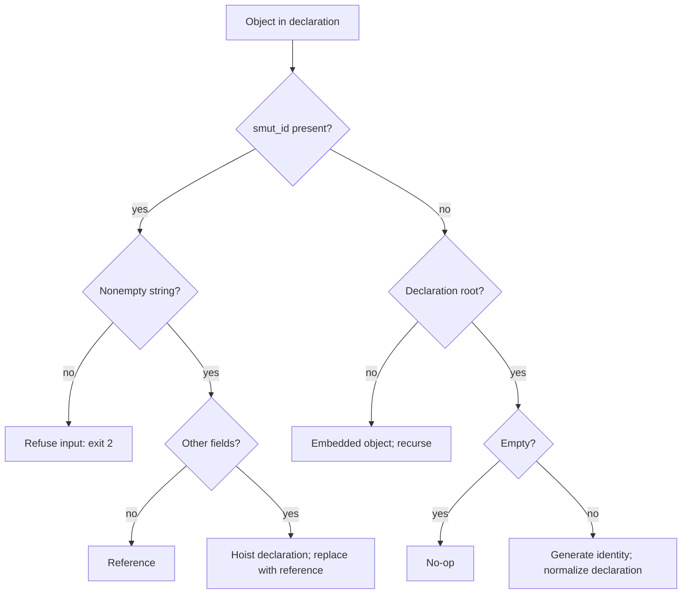
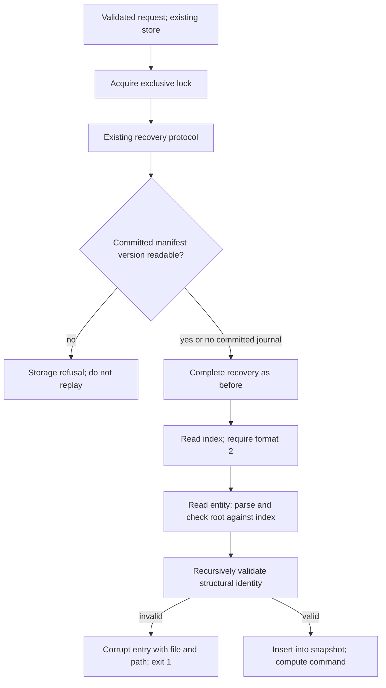

<!-- doctrine:section sec-1 -->
## 1. Change and boundaries

smut treats an object carrying its identity key as graph structure: a key-only
object is a reference, and an object with additional fields is an entity
declaration. Today that key is `id`, so an imported payload with its own `id`
can silently create an entity or become a reference instead of remaining data.

This change makes `smut_id` the structural identity key and frees ordinary `id`
for caller data at every depth. The identity key remains reserved; the other
existing value conventions, including the top-level `"DROP"` patch sentinel,
remain unchanged. ADR-001 governs that boundary.

For example, the declaration below creates one entity, `note`, and keeps its
external payload embedded:

```json
{
  "smut_id": "note",
  "external": {"id": 7, "name": "Imported item"},
  "related": {"smut_id": "other"}
}
```

The `related` object is a reference to `other`; a missing target is permitted
and reported under the existing rules. Ordinary `external.id` has no identity
meaning. Existing public id values stay opaque and unchanged.

The rename applies to entity files, declarations, references, returned entities,
previous entities in change receipts, convention declarations, and the subject
field of a change receipt (`changes[].smut_id`). Container-named values retain
their names: `ids`, `deleted`, `missing`, `frontier`, `depths`, edge
`source`/`target`, and dangling-reference `source`/`target`.

The store format moves from version 1 to version 2. Old stores and old committed
journal manifests are refused by version with exit 1, naming the version found
and the version this build reads. There is no migration, compatibility reader,
alias, repair path or release-specific migration advice (DEC-022).

The same change closes the loader-validation gap behind IMP-005. Before an entity
enters a loaded snapshot, an eager recursive check establishes that every
structural `smut_id` is a nonempty string. Malformed identity is storage
corruption, reported with exit 1 and the entity file and offending path.
`scan_refs` retains its non-fallible interface and validated-input precondition
(DEC-021).

The implementation brief remains normative and is updated in place (DEC-023).
`docs/store-format.md` remains the single on-disk format record and changes in
the same unit under STD-001. DEC-020 defines the key's single code definition and
surface pins; DEC-024 governs verification of the rename; DEC-025 governs the
six affected decision amendments.

Storage layout, internal basenames, locking, journal publication and durability
protocols, query algorithms, patch algebra and missing-reference behavior retain
their existing contracts. This slice changes the identity spelling, format
version and loader validation, together with their documentation, fixtures and
verification. Minting ids, renaming entities, short flags, Mermaid and other
remaining 1.0 work retain their separate ownership.

<!-- doctrine:section sec-2 -->
## 2. Identity rules and wire contract

### One definition and unchanged interfaces

`src/entity.rs::ENTITY_ID` keeps its name and becomes `"smut_id"`. It remains
the code definition used by identity parsing, normalization, reference scanning,
projection, ordering where identity is addressed, persistence and canonical
serialization. A literal wire-contract assertion pins its value (DEC-020).
The change adds no identity module or alias.

The existing `reference_id`, `extract` and `scan_refs` signatures remain.
`reference_id` continues to distinguish absence from invalid identity; changing
the key does not soften invalid structural identity into embedded data.
`src/declare.rs` uses the constant when emitting a change receipt's subject.
`src/conventions.rs` uses it for the fixed-id declaration returned as JSON.

### Declaration interpretation

The table describes the meaning of objects in a declaration:

| Object | Meaning |
| --- | --- |
| Has a nonempty string `smut_id`, no other fields | Reference; does not create an entity or placeholder |
| Has a nonempty string `smut_id` plus other fields | Declaration; hoist it and replace the occurrence with a key-only reference |
| Has `smut_id` with null, empty string or any non-string value | Invalid identity; refuse the request at exit 2 |
| Has no `smut_id`, is a nonempty declaration root | Generate identity under the existing collision-avoidance rules |
| Has no `smut_id`, is an empty declaration root | Existing no-op |
| Has no `smut_id`, is nested | Embedded value; recurse to discover structural declarations/references inside it |

A whitespace-only identity remains a valid nonempty string. Identity values stay
case-sensitive, opaque and unnormalized. Generation still avoids stored ids,
explicit structural ids throughout the batch and ids already generated in the
batch. An ordinary payload `id` does not identify an entity or occupy that
structural namespace.

This diagram distinguishes declaration roots from nested payloads:



The root exception is the existing automatic-generation rule, not a new way of
marking nested entities. A root such as `{"id":"external"}` now gets a generated
`smut_id` and stores its `id` as an ordinary field. A client still sending the
old spelling cannot be distinguished from a caller intentionally storing that
field; no compatibility interpretation or typo refusal is added.

### Reading, projection and canonical bytes

A field name in `where`, `select`, `order` or `follow` continues to address
that actual top-level field. Address identity with `smut_id`; `id` now
addresses caller data and may legitimately match a predicate or contain references
to traverse. The query grammar does not change.

Every projected entity retains `smut_id` regardless of selection;
`select: []` returns identity alone. Ordinary `id` is projected like any other
data field. Entity-shaped objects serialize with `smut_id` first and remaining
keys lexical, wherever they occur; embedded ordinary objects remain all-lexical
and arrays keep their order. File output stays pretty JSON with a trailing
newline, and command stdout stays compact JSON with a trailing newline.

For `smut declare '{"smut_id":"note","id":7}'` against an absent entity, the
response is:

```json
{"changes":[{"smut_id":"note","previous":null,"status":"created"}],"ids":["note"],"missing":[]}
```

Only the subject field changes in that envelope. `previous` remains the full
pre-batch entity when supplied, using `smut_id`; the compact flag and
created/updated/unchanged rules retain their meanings. Response containers and
traversal metadata keep the names set out in section 1.

Verification must exercise the root and nested cases separately, including mixed
`smut_id` and ordinary `id` in the same object, projection of each, malformed
structural identity, nested hoisting, forward references, and a nontrivial
canonical-order example where an ordinary key would otherwise precede identity.

Ordinary `id` follows the existing field patch rules, including the top-level
`"DROP"` sentinel. Releasing the key for data does not introduce a separate
literal-assignment syntax or bypass patch interpretation.

<!-- doctrine:section sec-3 -->
## 3. Loader validation and format refusal

### Ownership and call order

`Store::load` owns validating stored identity. It already parses every indexed
entity, checks that it is an object and checks root identity against the index.
After those checks and before inserting the entity into `Snapshot`, add a
private helper in `src/store/mod.rs`:

```rust
fn validate_identity_tree(entry: &str, value: &Value) -> Result<(), StoreError>;
```

Its internal recursive walk calls `crate::entity::reference_id` for objects,
descends through all their values and through arrays, and ignores scalar values.
The predicate decides validity; the store layer converts a failure to
`StoreError::Corrupt`. No storage type or filesystem dependency enters
`src/entity.rs`. Existing root-object and root/index-disagreement diagnostics
retain their precedence. The walk does not stop at a valid reference-shaped
object: every nested object in the loaded value must satisfy the identity rule.

This establishes the precondition of `scan_refs` without changing its return
type or threading storage errors through traversal. It does not check whether
reference targets exist, invent placeholders, rewrite data or introduce a new
normalization/repair pass. Ordinary `id` is not validated as identity, even
when its value is null, empty, numeric, an array or another object; structural
`smut_id` objects nested within that value are still found.

The walk adds linear work over each already-parsed entity and stack/path storage
proportional to its nesting depth. It does not re-read or re-parse the file.
Every normal store-backed read uses the same loading boundary, so both `get`
and traversal refuse the malformed store consistently, even when the bad
identity is under a field the requested traversal would not follow.

### Unambiguous diagnostic paths

Use a root marker `$`, JSON-quoted object-key components in brackets and
numeric array components: for example
`$["payload"]["tags"][2]["smut_id"]`. Encode object-key text with JSON string
escaping, so dots, brackets, quotes, slashes, control characters and empty keys
cannot be confused with separators. This is a diagnostic notation only, not
new query syntax.

Traverse object keys lexically and arrays in positional order, returning the
first invalid structural identity. Within one entity the result is deterministic;
the existing index iteration determines which entity is loaded first.
The error names the indexed basename and the identity member's path, not merely
its containing object. A proposed exact reason is:

```text
identity at $["payload"]["tags"][2]["smut_id"] must be a nonempty string
```

The existing `StoreError::Corrupt { entry, reason }` display and CLI prefix
produce, for example:

```text
smut: Ab3.json is not a valid store entry: identity at $["payload"]["tags"][2]["smut_id"] must be a nonempty string
```

Invalid request identity remains exit 2; malformed stored identity is exit 1.
No success envelope is emitted on failure. Keep the internal `scan_refs`
assertion for an impossible malformed validated input; update its spelling.

### Version 2 and recovery

Set both `src/store/index.rs::FORMAT_VERSION` and
`src/store/journal.rs::MANIFEST_FORMAT_VERSION` to 2. Keep their existing
parsers and refusal classes; no permissive reader or new error variant is needed.
A version-1 index uses the existing diagnostic with its found/expected values:

```text
smut: the store index has format_version 1, and this build reads only 2
```

The corresponding manifest refusal also names found and expected versions and
exits 1. A committed version-1 manifest must fail parsing before any staged put
or removal is replayed.

This sequence shows the retained recovery-before-load boundary:



The diagram focuses on the new version and identity boundaries. Existing
ambiguity, symlink and write-set checks still apply inside recovery. Do not move
normal store validation ahead of recovery: a crashed valid store must recover
before its committed files are judged. Prepare-state discard, done-state cleanup,
protocol temporary removal, locking, barriers and roll-forward behavior remain
as specified. In particular, the new loader check itself performs no writes;
a store command can still perform existing recovery bookkeeping before loading.
The refusal promise for an old committed manifest is no replay, not a promise of
zero bookkeeping mutations before the version is checked.

Version-2 manifests continue to use the existing staged-entry validation and
replay algorithm. This slice does not add a separate semantic parser for journal
entity bytes; the normal loader validates the resulting store before serving
the command. `docs/store-format.md` must describe the version break, nested
identity corruption rule, path notation and worked diagnostics in the same
change (STD-001).

<!-- doctrine:section sec-4 -->
## 4. Code impact and documentation ownership

### Design targets

The table is the code-impact contract; design-target selectors mirror its paths.
A listed consumer that already reads `ENTITY_ID` needs no production rewrite
solely to replace the spelling. Its embedded fixtures, comments and behavioral
pins still require inspection. Preserve unrelated behavior rather than treating
the list as permission to refactor.

| Path | Intended change |
| --- | --- |
| `src/entity.rs` | Set `ENTITY_ID` to `smut_id`; retain predicate/extraction/scanning interfaces; update identity-related comments, diagnostics and tests; pin the literal wire contract |
| `src/declare.rs` | Emit the change-receipt subject using `ENTITY_ID`; preserve normalization, conflict algebra, generation and response containers; update examples/tests |
| `src/conventions.rs` | Emit the fixed-id convention declaration using `ENTITY_ID`; update its tests/comments without changing seed ids or content |
| `src/store/**` | Set index and manifest format versions to 2; add the private recursive loaded-identity validator; retain root checks and recovery ordering; update format-bearing tests |
| `src/walk.rs`, `src/select.rs`, `src/order.rs` | Verify shared identity consumers and update structural examples/fixtures; keep algorithms and internal ids-as-values unchanged |
| `src/render_markdown.rs` | Inspect identity/reference examples and pins; retain rendering behavior and identity display as a value |
| `src/cli.rs` | Update structural examples/tests; retain grammar, flags and generation policy |
| `src/learn.rs` | Update declaring/reference/query/traversal prose, two-call recipe and executed examples; keep prose pins, without interpolating the guide from the constant |
| `tests/**` | Update structural input/expected-output keys; add the identity, corruption and version refusal cases; retain regression coverage and the single interview fixture |
| `docs/store-format.md` | Document version 2 in index and manifest, structural identity, canonical bytes, nested-identity refusal and diagnostic examples |
| `README.md` | Update declarations, response examples and sharp edges while preserving the operator's active draft |
| `smut-implementation-brief.org` | Update normative identity rules, relevant response/example keys and the format-version example; retain unfinished 1.0 requirements |
| `.doctrine/knowledge/decision/002/record-002.*`, `005/record-005.*`, `007/record-007.*`, `010/record-010.*`, `012/record-012.*`, `016/record-016.*` under the same decision directory | Reconcile only the affected facet/prose passages as described below |

The store validator uses `reference_id` from the entity module; that import is
the existing direction of dependency, not a new store dependency in the core.
Use `StoreError::Corrupt` and its current display, so no new public error
variant is required. Internal `Id`, `Change.id`, map-key and basename variable
names need not become `smut_id`: they describe values/types, not JSON members.

### Documentation contract

The normative implementation brief describes the intended product, including
unfinished Mermaid and 1.0 work. Updating identity examples does not claim those
features shipped. The store-format document records the actual on-disk contract
under STD-001; the brief's version example must agree with it. README and
`learn` describe the shipped surface, not pending features.

The guide must explicitly teach that `smut_id` is structural, ordinary `id`
is data, and identity predicates/projections use the new key. State that old
stores are refused and retain the existing value boundaries, notably `DROP`.
The two-call recipe keeps its completeness guard and backlink direction; only
identity-field spelling changes.

The operator is actively editing README. Before its implementation edit, inspect
both staged and working-tree changes, coordinate the affected passages, and
preserve that work. No blanket replacement, overwrite, checkout/reset or broad
commit is appropriate. Changes to fixture provenance explain the key adaptation
without changing the original source-snapshot facts or its privacy ruling.

### Accepted decision amendments

During reconciliation, use the knowledge editing surface for facet fields and
prose as needed; do not hand-edit record TOML. Each targeted amendment carries a
date and cites ADR-001 and SL-004. Preserve durable ids and unrelated rationale.

| Record | Current governing amendment |
| --- | --- |
| DEC-005 | Structural identity is `smut_id`; ordinary `id` may be inline metadata. Preserve shared predicate, hoisting, labels, preorder and error classes; cite DEC-021 for loader enforcement |
| DEC-007 | Identity-first bytes and identity retained in projection use `smut_id`, including `select: []`; other envelope rules remain |
| DEC-010 | Identity-related documentation obligations and format version match the new contract; retain the durability guarantee and ownership boundaries |
| DEC-016 | Update identity spelling in the normative two-call recipe; retain roots-only filtering, completeness guard and relation direction |
| DEC-002 | Update structural identity in examples; preserve Set/Drop algebra, equality and batch semantics |
| DEC-012 | Update entity identity in the example; retain `depths`, `edges`, `frontier`, endpoint names and traversal behavior |

ADR-001 and STD-001 govern these changes and need no amendment to authorize them.
The old six DECs are not wholesale superseded. Review the completed prose and
facet edits together so an updated body cannot coexist with a contradictory
facet choice.

<!-- doctrine:section sec-5 -->
## 5. Verification and fixture preservation

### Behavioral evidence

Verification has three distinct jobs: show the new identity contract, preserve
unrelated behavior, and establish the loader's refusal boundary. Renaming both
input and expected output in existing tests is not enough to establish the first
or second job. Add focused cases rather than a test mirroring each implementation
branch.

| Behavior | Evidence and appropriate home |
| --- | --- |
| Key is a deliberate wire contract | Literal `ENTITY_ID == "smut_id"` assertion in entity tests (DEC-020) |
| Ordinary `id` survives | CLI round trips for top-level ordinary `id` beside explicit/generated `smut_id`, plus nested string, empty string, number, null, array and object values; no unintended hoisted entity or missing target |
| Structural identity still controls graph shape | References, nested declarations, forward references, root generation, explicit malformed identity refusal and collision avoidance retain their contracts |
| Field operations distinguish identity and data | Query by `smut_id` and by ordinary `id` against mixed data; project identity alone and identity plus `id`; preserve ordinary-field ordering and top-level patch semantics |
| Serialization is structural | Stored and projected entities and receipts put `smut_id` first even beside lexically earlier ordinary keys; embedded nonentity objects remain lexical |
| Receipts and conventions use the new key | Pin `changes[].smut_id`, entity-shaped `previous`, compact behavior and the JSON conventions declaration; container-named values retain their names |
| Nested stored malformation is refused | Extend `tests/store_corruption.rs` and CLI coverage: malformed `smut_id` under objects and arrays is exit 1, with the basename and exact diagnostic path, for both `get` and traversal |
| Loader validates every loaded object | Put corruption under a field not requested by `follow`; traversal must still refuse instead of reaching `scan_refs`' assertion |
| Path notation is unambiguous | Object keys with dots, brackets, quotes, empty strings and escaped characters yield distinct JSON-quoted path components; include an array position |
| Error classes retain their boundary | The analogous request with malformed `smut_id` is exit 2, not storage corruption; ordinary `id` with those values is valid data |
| Old index is refused | Build a version-1 store explicitly; require exit 1 with found 1/expected 2 and no success envelope |
| Old committed journal is not replayed | Build a version-1 commit manifest with staged puts/removals; require version refusal and verify no staged file was published or target removed |
| New format is recoverable | Existing interruption/concurrency suites run against version 2; a valid interrupted committed batch recovers under the established contract |

For malformed-store probes, capture the entity/index bytes before the command
and show that loader validation has not repaired them. Do not demand zero writes
from the command's existing lock/recovery bookkeeping. For old committed-journal
tests, check replay effects separately from cleanup of protocol temporaries.

The read-only public probes use scratch stores, not the operator's live store.
Repeat the original IMP-005 shape under `smut_id` and require a clean refusal,
not merely absence of panic. `get` and traversal must fail with empty stdout
and the documented exit class.

### Independent fixture equivalence

Adapt the single committed interview declaration array structurally. Rename only
identity member keys, preserving all entity ids, reference target strings,
ordinary fields and their values, numeric representation distinctions, entity
array order and nested array order. Do not replace the text `id` in stored
prose or change historical quotations of old behavior.

Before editing, identify and record the exact Git revision supplying the original
fixture. The original can be read into scratch space through Git; do not commit a
second full copy or require Git at normal application/test runtime. At adaptation
and audit, inverse-map only the adapted structural identity keys and compare
against that original using the project's structural JSON equality, which keeps
`1` distinct from `1.0`. JSON object member ordering is immaterial for this
comparison; canonical-byte ordering has its own tests.

The check must reject a changed target/value, missing entity or reordered array.
Exercise a representative altered copy as a negative control before trusting the
comparison result. Keep the baseline revision and the command/result in slice
evidence so audit can repeat the check; no new persistent fixture mirror is
needed. Re-run fixture, traversal and selection assertions and the executed
guide examples against the adapted array.

### Residual search and documentation review

Search code, tests, fixture metadata, the normative brief, README, `learn`,
store-format prose and the six amended decisions for old identity-field uses.
Classify residual `id` occurrences as ordinary payload data, public-id value or
internal vocabulary, historical quotation/version-refusal fixture, or missed
structural use. Only the last category is a failure of the sweep. A raw
occurrence count or blanket ban is not a correctness gate.

Execute the README transcript and guide examples using their existing tests.
Inspect prose pins so they assert the new rule rather than merely deleting old
sentences. Review the brief as a normative document, including still-unfulfilled
1.0 scope, and review `docs/store-format.md` against code and worked diagnostics
under STD-001. No grep test substitutes for that format-document review.

### Completion evidence

Run the repository gate `just check`: build, clippy in both feature
configurations with warnings denied, formatting, and the default and
fault-injection test runs. Inspect the complete diff for removed/disabled tests,
weakened expectations and unrelated edits.

A scripted version-2 lifecycle covers declare, query, render and delete with
both structural `smut_id` and ordinary `id`. Retain evidence of old-index
refusal, old-manifest no-replay, clean corruption refusal, fixture equivalence,
executed examples, residual classification and the six decision amendments.
These checks establish the documented Linux/recovery model; they do not turn
fault-injection evidence into a new power-loss or portability guarantee.

<!-- doctrine:section sec-6 -->
## 6. Risks, assumptions and release boundaries

The main compatibility risk is silent meaning change for a caller still sending
the old field: ordinary `id` is valid data, so rejecting it would contradict
the feature. Documentation, new behavior cases and executed examples make the
new contract explicit; no compatibility interpretation is added. Old on-disk
stores are different: their version supplies an unambiguous refusal boundary.
The operator accepts the lack of legacy compatibility (ADR-001, DEC-022).

The new validation pass visits each loaded entity before any normal command
computation. That adds work to every store-backed operation, not just traversal.
It remains linear in parsed data size and accepts the current whole-store-loading
architecture. A broader lazy-loading or traversal-error redesign is outside this
slice. Diagnostic paths allocate only the traversal path and the final error
representation as needed; do not repeatedly serialize or clone entire entity
subtrees to compute them.

The store still reserves `smut_id` at every depth. A payload that intentionally
uses that spelling is interpreted structurally. The `DROP` patch sentinel,
predicate operator syntax, missing-versus-null distinction and opaque-id rules
retain their existing boundaries. This design does not promise literal storage
of every possible JSON payload without conventions.

The fixture carries historical product evidence, including descriptions of old
behavior. Preserve its prose and data while adapting its structural identity
keys. Inverse fixture comparison, behavior tests and residual review cover
different failure modes; none replaces the others.

README remains the operator's live draft and requires coordination at execution.
No implementation or commit may discard or silently absorb their unrelated
changes. The design can be approved independently of that later editing step.

The six decisions need coherent facet and prose amendments, and the normative
brief must remain current while its 1.0 requirements remain unfinished.
Completing code without those documentation/reconciliation obligations does not
complete this slice. STD-001 makes the format document part of the same change.

No technical inquiry remains open in the design. The precision added here
(private validator placement, diagnostic path notation, test homes and selector
paths) implements the settled decisions rather than changing identity policy.
Implementation planning determines phase boundaries and task order; it must
carry the verification obligations in section 5 and the reconciliation targets
in section 4.

The change does not authorize migration, a minting or rename verb, short aliases,
Mermaid, chronology fields, filename redesign, extra convention sets, dependency
changes or a new public library API. Those surfaces retain their existing
backlog ownership. The operating-system, filesystem and recovery guarantees
remain those documented for the existing store.

