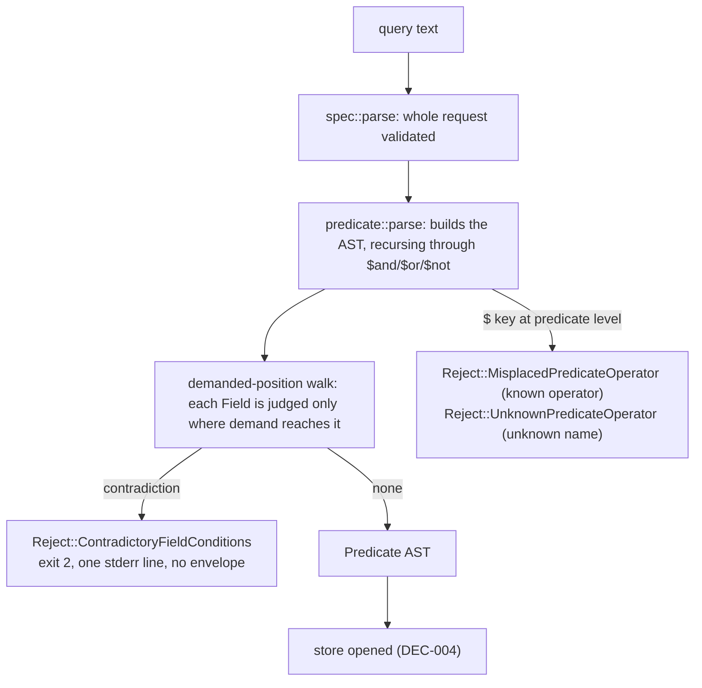

<!-- doctrine:section sec-1 -->
## 1. What changes, and where the boundary sits

Today a `where` predicate that no entity could ever satisfy is accepted, run, and
answered with an empty result and exit 0. Two shapes of that silence were measured
on 0.2.0, against a two-entity store:

```
smut query '{"where":{"status":{"$eq":"open","$ne":"open"}}}'
  → {"dangling":[],"missing":[],"objects":[],…}   exit 0

smut query '{"where":{"status":{"$in":["open"],"$contains":"zzz"}}}'
  → {"dangling":[],"missing":[],"objects":[],…}   exit 0
```

Both are well-formed questions with a known-false answer, and both are
indistinguishable from a genuine empty result. This design adds one refusal class — a
field whose conditions cannot all hold — and repairs one message that already exists
for a different defect.

The second refusal is not a new class of failure. A `$`-keyed member at the predicate's
top level is *already* refused; the defect is that the sentence says `unknown predicate
operator: $ne`, which sends a caller to check the operator list rather than to the
position they got wrong.

The boundary the design keeps:



The diagram's purpose is the ordering and the loop: `parse` re-enters itself for every
clause operand, so the contradiction check cannot live in `parse_field` — it needs to
know whether the field's conditions are *demanded* (§2). Nothing on the refusal path
reaches a store, a clock or the filesystem, so a refusal cannot leave a store
half-created, half-locked or half-written. `predicate::parse` has one external ingress
(`src/spec.rs:132`) and recurses within the module; the predicate module's own doc
claims that no-reach property for everything below it, and this design adds no reach
that would break it.

What deliberately does not change: the exit-code taxonomy (still `Reject` → 2 and
`StoreError` → 1, with nothing in between), the response envelope (still the 0.1 five
keys plus the conditional `traversal`), the guide text, and the field-level
`MixedPredicateObject` message, which already names its field and states its cure.

<!-- doctrine:section sec-2 -->
## 2. The decidable rule

The question is narrow: given **one field's** conditions, is the conjunction
unsatisfiable for *every* possible field value? A yes is a proof, so a refusal can
never be wrong about the conditions it names.

### Where the check fires — demanded position only

A proof about one field is not yet a proof about the query. A `where` is a tree, and
the same field condition means different things under different clauses. What matters
is whether the predicate could hold *at all* if that field's conditions did not:

| position | effect of a condition that cannot hold |
| --- | --- |
| demanded — the root and `And` children, however many `$not`s wrap them | the whole predicate is false for every entity: the query answers nothing, always |
| inside an `$or` that must hold | a false disjunct leaves the others to decide; the query still answers |
| under an odd number of `$not`s | a false inner predicate makes `$not` **true**; the query answers everything |

The first row is the silent-empty defect this design exists to remove; the other two
are not. Measured on 0.2.0: `{"$not":{"status":{"$eq":"open","$ne":"open"}}}` returns
the whole store, and `{"$or":[{…contradiction…},{"type":"question"}]}` returns rows.
Refusing either would reject a query whose correct answer is known and non-empty.

The walk therefore carries a **demand** flag, which is a propagation rule and not a
counting rule:

- the root is demanded;
- `And` passes demand on to every child — a conjunct must hold if the `And` must;
- `Not` flips demand;
- `Or` determines its children only when the `Or` is itself demanded **false**;
- a `Field` is judged iff it arrives demanded.

Two consequences the prose must not blur. First, **parity alone is not the rule**:
`{"$or":[{"$not":{"$not":{"f":{"$eq":1,"$ne":1}}}},{"g":2}]}` has two `$not`s around the
contradiction and is still satisfied by any `g: 2` entity, because the `$or` was never
analysed — the walk correctly refuses nothing. Second, the `Not` flip is why this is a
walk and not a "top level only" test:
`{"$not":{"$not":{"f":{"$eq":1,"$ne":1}}}}` empties the query exactly as the undoubled
shape does, and is refused.

### Why the rule is short

A condition object carries **each operator at most once**: no `Value` escapes the input
parser with a repeated key (`src/input.rs` refuses a repeated key in any object, at any
depth, as it reads; DEC-001 rule 1 makes that exit 2). With a closed operator set of
five (`$eq`, `$ne`, `$in`, `$exists`, `$contains`), a field has at most five
conditions, and `serde_json`'s map is ordered, so iteration is deterministic. A `Field`
always carries **at least one** condition: `parse_field` turns any value without `$`
keys into a single `Eq`, and a `$`-only object yields one condition per key — which is
why a judged `Field` is never vacuously true and a *not*-demanded `Field` never needs a
refusal.

That fact is why the rule is a short procedure rather than a lattice — and it is the
reason this slice never needed an enumeration of pairs. Two of the forms this slice was
originally cut with need the same key twice and so cannot be written at all:

```
{"$in":["a"],"$in":["b"]}      → duplicate JSON key: $in
{"$exists":true,"$exists":false} → duplicate JSON key: $exists
```

### The criterion: bound the value, then evaluate

There is exactly one genuinely undecidable shape — **`$contains` applied to a value the
request does not bound**, because a substring test over an unknown string has no finite
answer. Every other shape bounds the field to one value or to a finite set of values,
and a bounded shape is decided by *evaluation*, using the same `Condition::holds` the
query itself will use.

| what the conditions bound the field to | how it is decided |
| --- | --- |
| nothing, with `$exists:false` beside anything else | absence and presence cannot both hold |
| one value — `$eq v` present | evaluate every other condition on `v` |
| a finite set — `$in S` present | some member of `S` must satisfy the other conditions |
| nothing at all — neither `$eq` nor `$in` | nothing is provable |

This is why the rule does not enumerate operator pairs: the pairs are consequences.

### The tests, in this order

The order is fixed, and it is **not** the object's key order — every sentence below is
reached by the operator order stated here, so the message for a predicate is the same
for every spelling of it.

1. **An empty `$in` cannot hold.** No value is a member of nothing.
2. **Absence beside anything else cannot hold.** `$exists:false` requires the field
   absent; every other condition requires it present.
3. **A pinned value decides the rest.** With `$eq v`, evaluate each remaining
   `$ne`/`$in`/`$contains` on `v`, in that order; the first that fails is the
   contradiction. (`$exists:true` cannot fail on a present value, so it needs no
   sentence.)
4. **A bounded set decides the rest.** With no `$eq` and a non-empty `$in S`, apply
   `$ne` to the members: if none survives, that is the contradiction. Otherwise apply
   `$contains` to those that survived: if none survives, that is the contradiction.

Nothing else is checked. A contradiction spanning `$and` clauses is out of scope by
decision.

### Shape of the check

```rust
/// Returns the contradiction that makes this field's conditions impossible, or
/// `None` when some value satisfies them all. Reads only the condition list.
fn contradiction(conditions: &[Condition]) -> Option<String>;

/// Walks the parsed predicate carrying whether it must hold, and judges a `Field`
/// only where it is demanded. `And` passes demand down; `Or` determines children
/// only when the `Or` must not hold; `Not` flips demand.
fn refusal(predicate: &Predicate, demanded: bool) -> Option<Reject> {
    match predicate {
        Predicate::Field(field, conditions) if demanded => contradiction(conditions)
            .map(|contradiction| Reject::ContradictoryFieldConditions {
                field: field.clone(),
                contradiction,
            }),
        Predicate::Field(..) => None,
        Predicate::And(children) if demanded => {
            children.iter().find_map(|child| refusal(child, true))
        }
        Predicate::And(_) => None,
        Predicate::Or(children) if !demanded => {
            children.iter().find_map(|child| refusal(child, false))
        }
        Predicate::Or(_) => None,
        Predicate::Not(inner) => refusal(inner, !demanded),
    }
}
```

Two pure functions over the parsed AST, and neither runs at a recursive return: the
private `parse_predicate` builds the tree, and the public `parse` calls `refusal` once
over the finished tree. Four properties matter and are stated so a reviewer can check
them:

- **Demanded position only.** Demand is propagated as above and never guessed; the
  `Or` arm's `if !demanded` is what keeps a false disjunct from being refused.
- **Fixed order.** Sentences come from the test order above and from the fixed operator
  order inside tests 3 and 4, never from whichever pair the object's keys yield first
  and never from the order of the caller's `$in` array.
- **Evaluation, not a second semantics.** Every decision is `Condition::holds(Some(v))`
  or its negation, so the refusal cannot disagree with the query it refuses: `$contains`
  of a number against a number, or `1` versus `1.0` under `serde_json` equality, are
  decided the way evaluation decides them.
- **No new reach.** No store, no clock, no filesystem, no new import beyond the
  module's existing `serde_json::Value` and `crate::error::Reject`.

### Why each refusal is impossible

| branch | why no value can satisfy it |
| --- | --- |
| `$in []` | no value is a member of the empty set |
| `$exists:false` beside any other condition | absent fails the other; present fails `$exists:false` |
| `$eq v` beside `$ne v` | one value, two incompatible requirements |
| `$eq v` beside an `$in` list not holding `v` | the pin excludes every listed value |
| `$eq v` beside a `$contains` that `v` does not satisfy | the pin fixes the value the test applies to |
| `$ne v` beside an `$in` list all of whose members equal `v` | every listed value is excluded |
| `$contains c` beside an `$in` list where no member satisfies `c` | the list is the whole candidate set, and none survives |

Each row is false for every store and for every entity, so no correct query changes its
result — given the demanded-position walk above, which is what keeps "correct query"
meaning the whole predicate rather than one conjunct of it.

<!-- doctrine:section sec-3 -->
## 3. The contradiction refusal

One variant, one `Display` arm, one row in the failure boundary table.

```rust
/// One field's conditions cannot all hold, so no entity can satisfy this
/// predicate. Provable from the condition list alone.
ContradictoryFieldConditions {
    /// The field whose conditions conflict.
    field: String,
    /// Which conditions conflict, for the message.
    contradiction: String,
},
```

```rust
Reject::ContradictoryFieldConditions { field, contradiction } => write!(
    formatter,
    "field {field} cannot be satisfied: {contradiction}"
),
```

Rendered on stderr by the existing renderer as one line:

```
smut: field status cannot be satisfied: $eq and $ne are given the same value
```

### The seven sentences

One per reachable branch of §2. These are pinned text: changing one is a contract
change, not an edit. Each is written to follow the frame without repeating its verb —
the frame already says *cannot be satisfied*, so a clause that says *cannot hold* would
stutter.

| branch | `contradiction` |
| --- | --- |
| `$in []` | `$in is given an empty list` |
| `$exists:false` beside any other condition | `$exists: false beside any other condition` |
| `$eq v` beside `$ne v` | `$eq and $ne are given the same value` |
| `$eq v` beside an `$in` list not holding `v` | `$in does not list the $eq value` |
| `$eq v` beside an unsatisfied `$contains` | `$contains is not satisfied by the $eq value` |
| `$ne v` beside an `$in` list all of whose members equal `v` | `$ne contradicts every value $in lists` |
| `$contains c` beside an `$in` list where no member satisfies `c` | `$contains is not satisfied by any value $in lists` |

Properties the sentences hold to: lower case, no trailing full stop, no field name
invented inside them (the field is named once, by the surrounding frame), no verb the
frame already carries, each names the operators it is about rather than describing the
general rule, and each is reached by the fixed order in §2 rather than by which key came
first.

### Why one variant and not seven, or one typed enum

- **Seven variants** would multiply `Display` arms and boundary-table rows for messages
  that differ in one clause, and would present seven classes to a caller that sees one
  behaviour: exit 2, no envelope.
- **A typed `Contradiction` enum** would buy compiler-checked exhaustiveness for a set
  that the tests already pin one message at a time — a type whose only consumer is the
  renderer is wording machinery wearing a type's clothes.
- **A description string** follows the eleven neighbours whose payload is already the
  prose their message needs (`found`, `expected`, `reason`), and keeps the detection
  and its wording in one place.

### Why the message carries no epigram

DEC-027's rationale — *a condition that can never hold is a typo, not a question* — is
the reason the refusal exists, and it stays in that decision and in the guide sentence
IMP-012 owes. stderr is a single line (`smut: {error}\n`), so a parenthetical would
ride on every instance of the refusal for the life of the format. The decision's own
illustration wraps it onto a second line; the renderer has no second line.

### What is untouched

`MixedPredicateObject` keeps its message byte for byte: `field {field} mixes a literal
with operator keys; compare the whole object with `$eq``. It names a field and states a
cure, and it is a different defect — an object the language gives no behaviour to,
rather than a conjunction that is merely false.

<!-- doctrine:section sec-4 -->
## 4. The predicate-level `$` message

One `Display` arm serves two different defects today, because `UnknownPredicateOperator`
is raised both at the predicate level (the `$` arm of `parse_predicate`) and inside a
condition object (`parse_condition`). Splitting them is the only way each sentence can
be true.

### The predicate level

A `$`-keyed member of the predicate object that **is** one of the five operators is not
unknown — it is in the wrong place. Three slips reach this arm:

| the caller wrote | what went wrong |
| --- | --- |
| `{"status":"open","$ne":"x"}` | an operator beside a field |
| `{"$ne":"x"}` | an operator with no field at all |
| `{"$and":[…],"$ne":"x"}` | an operator beside a clause |

```rust
Reject::MisplacedPredicateOperator { operator } => write!(
    formatter,
    "predicate operator {operator} belongs inside a field's condition object: \
     {{\"<field>\": {{\"{operator}\": <operand>}}}}"
),
```

```
smut: predicate operator $ne belongs inside a field's condition object: {"<field>": {"$ne": <operand>}}
```

- **Both slots interpolate.** The operator appears as the key in the suggested shape,
  so the sentence cannot disagree with itself — an implementation that named `$eq` in
  the frame and left `{"$ne": …}` literal would emit `predicate operator $eq belongs
  inside … {"$ne": …}`, which is why the tests pin two whole lines, one per operator.
- **The operand is a placeholder too.** `$in` takes an array and `$exists` a boolean, so
  a literal `"x"` would tell an `$in` or `$exists` caller to write a shape that is
  itself refused. `<operand>` is faithful to every operator and costs only the
  copy-paste; supplying the field and the operand is the step the sentence exists to
  prompt.
- **A placeholder, never a field.** A predicate-level `$` key carries no field to name,
  and the original proposal printed `status` — a field the caller may not have.
  `<field>` states that no field is being named.
- **Position, not kind.** The sentence describes where an operator belongs rather than
  what it sits beside, which is why it reads correctly for all three slips.

### Both levels: a name the language does not define

```
smut: unknown predicate operator: $foo
```

`Reject::UnknownPredicateOperator { operator }` keeps its variant, its message and both
of its call sites. `$foo` really is unknown, at either level, and that is a different
defect from a known operator in the wrong place. The sentence also stays for a clause
used as a condition (`{"x":{"$and":[]}}`): `$and` is not an operator. A wrong operand on
a clause is still the operand's own refusal — `{"$or":1}` reports `$or must be an array
of predicate objects`, not a placement problem.

### What does not change

The exit code (2 for both), the absence of an envelope, and the operator name appearing
in both messages — the existing pins assert that a `$foo` refusal names `$foo`, and they
survive unchanged.

### What is pinned

The two sentences are pinned whole, not by substring, and the misplaced one is pinned
for two operators (`$ne` and `$in`) so that both interpolation slots are covered. A
substring assertion would pass a message that printed a concrete field name, which is
the one thing this sentence may never do.

<!-- doctrine:section sec-5 -->
## 5. Verification

Three levels, each owning one thing. A test that could be written at two levels is
written at the level whose failure it would be. The non-refusal cases are **pins**:
they pass with the feature absent, and their job is to fail if a later reader widens the
rule. The refusal cases are red-first.

### Unit level — `src/predicate.rs`

| test | covers |
| --- | --- |
| `parse_refuses_a_contradiction_naming_the_field_and_the_reason` | **red first.** Table-driven over §2's seven-row impossibility table: the variant, the field, and the `contradiction` sentence. |
| `a_contradiction_is_refused_only_where_it_is_demanded` | **red first** for the refused rows, **pins** for the rest. Seven shapes, one table: refused at the root, under `$and`, and under `$not` twice; not refused under `$not` once, inside `$or`, inside `$and`-under-`$not`, or inside `$or`-under-`$not`. |
| `parse_accepts_satisfiable_combinations` | positive controls: `$eq v` with `$in [v]`; `$eq v` with a `$contains` it satisfies; `$ne v` with `$in` holding a different value; `$exists:true` with `$eq`; `$contains` alone; `$in S` where one member satisfies `$contains`; `$ne` alone |
| `the_sentence_is_chosen_by_the_fixed_order` | `{"$eq":1,"$ne":1,"$contains":"z"}` reports `$ne`'s sentence. Lexical key order would reach `$contains` first, so this fails for a list-order implementation. (Swapping the two keys is not a test: `serde_json`'s map is a `BTreeMap`, so both spellings deserialize to the same `Value`.) |
| `a_contradiction_spanning_and_clauses_is_not_refused` | **pin.** `{"$and":[{"f":{"$eq":1}},{"f":{"$ne":1}}]}` parses: the check is inside one field's list by construction. |
| `a_single_disjunct_or_is_not_refused` | **pin.** `{"$or":[{"f":{"$eq":1,"$ne":1}}]}` parses. It empties the query, and it is one of the documented gaps (§7): the walk does not analyse `$or` contents, so closing this one shape would imply the rest are analysed. Breaking this test is a decision, not a cleanup. |
| `an_unbounded_contains_is_not_refused` | **pin.** `$contains` with neither `$eq` nor `$in` parses. This is the one shape the rule cannot decide, and the test says it is a limit, not an oversight. |

The positive controls are the ones that would fail if the rule were widened carelessly;
they are written before the rule, and stay green throughout.

### Message level — `src/error.rs`

- The contradiction's rendered text names the field and the contradiction:
  `field status cannot be satisfied: $eq and $ne are given the same value`.
- The misplaced operator's rendered text is asserted **whole**, twice — once for `$ne`
  and once for `$in` — so both interpolation slots are covered:
  `predicate operator $ne belongs inside a field's condition object: {"<field>": {"$ne": <operand>}}`.
- Two rows added to `the_boundary_maps_each_failure_class_to_its_exit_code` — the
  fixed-size array goes from 24 to 26 — pinning exit 2 for both new variants.
- The existing `$foo` test stays as it is, and is the evidence that the unknown-name
  message did not move.

### Binary level — `tests/predicates.rs`

Process-level promises that no unit test can see, in the existing table of malformed
predicates:

| assertion | why here |
| --- | --- |
| contradiction: exit 2, **empty stdout**, stderr names the field | "no success envelope on failure" is structural, and a refusal that printed one would still be green at unit level |
| contradiction: exit 2, and the scratch directory holds **no store** after the refusal | exit 2 is what proves the ordering: a request validated *after* the store step, against an absent store, exits 1 (`no store at …`). The absent directory is a non-vacuity check rather than evidence — a `query` never creates a store (`Query::creates_store()` is false), so that half cannot fail (EX-6) |
| misplaced operator: exit 2, stderr is the pinned line, `{"<field>": …}` and no concrete field name | the only assertion that fails if the sentence is reverted *or* if a field is invented. **Two strings, not one:** the message-level pin in `src/error.rs` is the bare sentence, and the binary pin here carries the renderer's `smut: ` prefix plus that sentence — the whole line, compared with `assert_eq!` |
| unknown `$foo` at predicate level: still exit 2, stderr still names `$foo` | proves the split did not reword the unknown-name case; pinned whole, as `smut: unknown predicate operator: $foo` — the prefix belongs to the binary-level assertion, not to the message |

A valid `where` through the same binary remains the paired success case, so a build
that refused every predicate cannot pass the suite.

### What is not tested, deliberately

No property test compares the rule against a satisfiability oracle: the rule is a
four-test procedure over a list of at most five conditions, and an oracle would be a
second implementation with no independent truth to appeal to. The completeness claim is
carried by argument (§2) and by one positive control per accepted shape.

<!-- doctrine:section sec-6 -->
## 6. Code impact

Three files. The selector set recorded for this slice is exactly this table.

| path | change |
| --- | --- |
| `src/predicate.rs` | `contradiction(&[Condition]) -> Option<String>` plus a `refusal(&Predicate, demanded) -> Option<Reject>` walk (§2), called once by `parse` over the finished AST — never at the end of the recursive `parse_predicate`, which re-enters itself per clause operand. The `$` arm of `parse_predicate` splits: a known operator (the five) becomes `MisplacedPredicateOperator`, anything else stays `UnknownPredicateOperator`. Unit tests as in §5, including the three pins. **No new import** beyond `Value` and `Reject`. |
| `src/error.rs` | two `Reject` variants (`ContradictoryFieldConditions`, `MisplacedPredicateOperator`), their `Display` arms (the misplaced one interpolating the operator into both slots of the shape), message tests for both, two rows in the boundary table (24 → 26). `UnknownPredicateOperator` is untouched along with its call sites and its message. |
| `tests/predicates.rs` | the contradiction rows, the misplaced-operator row asserted as a whole line, and the unknown-`$foo` row, in the existing malformed-predicate table and its paired success case. **One comment is reworded:** the doc on the unknown-operator test says any `$` key other than a clause is an unknown operator, which the split makes false for the five operators; the assertions stay, the prose becomes "a name the language does not define". |

### What is deliberately not in the diff

- `src/spec.rs` — the call site (`spec.rs:132`) is unchanged; the check rides inside
  `predicate::parse`, which is why no plumbing is added.
- `src/learn.rs` — no guide text, so no pin churn inside SL-004's surface.
- `src/input.rs`, `src/store/**`, `src/render_markdown.rs` — untouched; the refusal is
  upstream of every one of them.

### Ordering against SL-004

SL-004's PHASE-02 also edits `src/error.rs` (it respells two identity messages), so this
slice's refusal had to land first; PHASE-02 then rebases on two added variants and two
added `Display` arms. That is a plan-time ordering constraint, not a design tradeoff —
the overlap costs a rebase only if the order is reversed. What happened: SL-004's
PHASE-01 completed at `da4c404` before this slice's code landed at `7347dff` and
`9727c1c`, and SL-004's PHASE-02 followed.

<!-- doctrine:section sec-7 -->
## 7. Constraints, compatibility and known gaps

### Compatibility is free, and stays documented as such

`where` is a 0.2 key, so no 0.1 query can express a predicate. DEC-019's property — an
unchanged 0.1 response — cannot move, and `tests/compatibility.rs` needs no re-cut.
Nothing is added to the envelope and nothing is written to stderr on a successful
command, so the nine `stderr.is_empty()` pins are untouched.

One behaviour does move, and it is the intended one: a caller that composes a predicate
at runtime from variables can synthesise a contradiction, and now gets exit 2 where it
previously got `[]`. Two concrete shapes of that, both worth a line in the release note:

- **A computed `$in` list that happens to be empty** now refuses (`$in is given an
  empty list`) instead of selecting nothing. Code that filters against a derived id
  list reaches this whenever the derivation yields nothing.
- **A computed operator or value pair** that collides now refuses. `from: []` remains
  the documented spelling for an intentional empty result; the refusal's own test says
  so in a comment.

### The known gaps, stated rather than hidden

A partial detector reads as assurance if its limits are unstated. This slice ships **no
guide text**, so after it, `smut learn` says a malformed predicate is exit 2 and says
nothing about which contradictions are caught. Four silences remain, and the guide
sentence IMP-012 owes should name the first two:

- **`$contains` with neither `$eq` nor `$in` beside it.** The field is unbounded, so a
  substring test has no finite answer; refusing it would mean guessing.
- **A contradiction outside demanded position** — inside an `$or`, or under an odd
  number of `$not`s. The query still has an answer there, so a refusal would change it.
- **A *must-hold* `$or` stops the walk.** Its contents are never analysed, so
  `{"$or":[{"f":{"$eq":1,"$ne":1}}]}` is accepted and empties the query, even though a
  one-element `$or` means exactly what its disjunct means. (An `$or` that must *not*
  hold is the other case: it hands its children `false`, so a `$not` beneath it restores
  demand and the field *is* judged.) Closing the one-element shape alone would imply the
  rest of `$or` is analysed, which it is not; the pin in §5 makes the choice explicit,
  and `{"$or":[]}` staying legal (false, selecting nothing) is part of the same
  decision.
- **A contradiction spanning `$and`, `$or` or `$not`** — across fields, or across
  clauses. Out of scope by decision.

### Risks carried into the plan

- **Message text is a surface.** Both new messages are pinned sentence by sentence, the
  misplaced one as a whole line for two operators. The tempting later "improvement" is
  to add detail; the recorded reason not to is DEC-030.
- **The demand walk is the subtle part.** It is the one place where a good-intentioned
  widening ("refuse everywhere") rejects correct queries, and a good-intentioned
  simplification ("only at the top level") re-opens the silent-empty defect under
  double negation. Both directions have a pin.
- **`src/error.rs` is shared with SL-004.** Ordering, per §6.
- **A bounded assumption.** SL-004 does not rewrite `tests/predicates.rs` or
  `src/error.rs` in its early phases. If it does, this slice waits rather than racing.

### What a reviewer should be able to falsify

Every claim in §2 and §5 is checkable against the source: that `Eq`, `Ne`, `In` and
`Contains` each require a present field; that a `Field` always carries at least one
condition, so a non-demanded field can never be vacuously true; that a repeated JSON key
is refused at any depth; that `Condition::holds` is the only evaluator, so refusal and
query share one semantics; that `parse` recurses through the clauses, which is why
demand must be propagated; that `predicate::parse` has one external ingress; and that
the renderer emits one line. If any of those is false, the branch that depends on it is
false with it.

