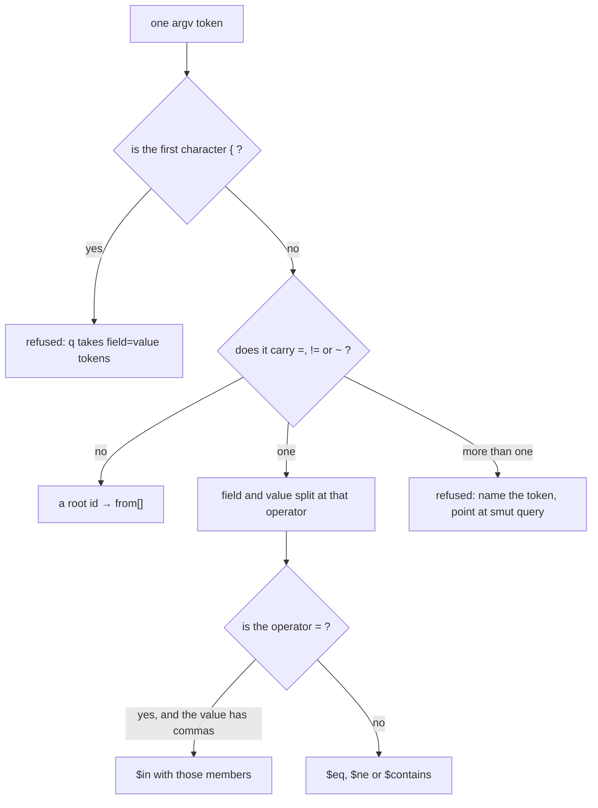
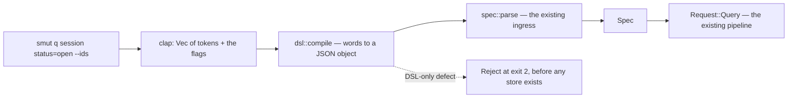

<!-- doctrine:section sec-1 -->
## The surface — what a human types

`smut q` takes a query as a line of words. Nothing is quoted *by the grammar*, nothing nests, and
the shape of the line is the shape of the request:

```console
$ smut q session --backlinks part-of --depth 2 --ids
["q-query","q-other"]
$ smut q q-query q-other status=open --ids
["q-query"]
```

One rule carries the whole surface: **a bare word is a thing, `field=value` is a filter, and
`--word` is structure.** The hot path therefore has no flags, and everything structural is
spelled out where a reader can see it — which is the real cure for the direction footgun the
guide already warns about:

```
smut q session --backlinks part-of --depth 2 --ids   # the questions under the session
smut q session --follow    part-of --depth 2 --ids   # the session, alone
```

### Tokens

| what is typed | what it means | what it becomes |
| --- | --- | --- |
| `session` | a root id | one entry in `from` |
| `status=open` | equals | `{"status": {"$eq": "open"}}` |
| `status!=open` | differs | `{"status": {"$ne": "open"}}` |
| `title~graph` | contains | `{"title": {"$contains": "graph"}}` |
| `status=open,resolved` | one of | `{"status": {"$in": ["open", "resolved"]}}` |

Roots and conditions may be interleaved in any order. Order is significant in exactly three
places: inside a comma list, inside `--order`, and the roots themselves, which are answered in the
order they are written — and `--from=ID` appends after them.

A token is classified by its own spelling, and never by looking at the store:



The "more than one" branch is what keeps the grammar honest: `status~a=b` is refused rather than
split at whichever operator the scanner happened to meet first, because either split would be a
guess and both guesses are silently wrong for somebody.

A token whose first character is `{` is not a root: the only thing a caller means by it is `smut
query`'s own argument, so it takes the refusal below. An id that really begins with `{` stays
reachable through `--from=ID`.

### Flags

| flag | specification key | note |
| --- | --- | --- |
| `--follow F[,F]` · `--follow any` | `follow` | `any` is the wildcard `"*"` |
| `--backlinks F[,F]` · `--backlinks any` | `backlinks` | deliberately adjacent to `--follow` |
| `--depth N` | `depth` | needs a direction (below) |
| `--budget N` | `budget` | needs a direction (below) |
| `--select F[,F]` | `select` | refuses `--ids` |
| `--ids` | `select: ["smut_id"]` | the two-call recipe's exact shape |
| `--order F[:asc\|:desc][,F…]` | `order` | direction defaults to `asc` |
| `--limit N` | `limit` | no `all` spelling exists |
| `--edges` | `edges` | |
| `--has F[,F]` | `where: {"$exists": true}` | `$exists` spelt shell-safely |
| `--missing F[,F]` | `where: {"$exists": false}` | |
| `--from=ID` | appends to `from` | the escape for a hostile id |

`--depth` and `--budget` are refused when no direction is named: the specification accepts and
ignores them, but a human typed `--depth 2` and meant it, and the human surface is allowed to be
stricter in strictness (never in meaning).

### The characters the grammar may not use

The grammar is designed around one constraint rather than tidied after the fact: **no spelling the
grammar invents uses a character the shell acts on.** Root ids and values are the caller's own
text, so `smut q 'a b'` still needs the shell's quotes and `--from=ID` is where an id beginning
`{` goes — and the tidy way to pass any id whose text the shell would otherwise touch. What the
constraint buys is that nothing the grammar *invents* — a wildcard, an existence test, an
operator — can be eaten or globbed. `*` would glob, `?` would glob, `$` would expand, a leading
`!` would expand history, `(` `)` `|` `&` `;` `<` `>` `#` and `` ` `` are all shell syntax, and a
leading `~` is tilde expansion.

Three consequences are deliberate rather than incidental:

- **The wildcard is the word `any`**, not `*`. The obvious spelling is the broken one, so the
  word that works is the word the guide teaches.
- **Existence is `--has` / `--missing`**, not `field?`. `?` is a single-character glob.
- **No `:` as an infix operator**, although `:` is shell-safe. Ids like `session:1` are
  plausible, and `smut q session:1` would then mean "field `session` contains `1`" — a silent
  wrong answer, which is the worst failure class available.

`--` still ends flags, so a hyphen-leading id stays reachable exactly as it is for `get`, and a
value containing a space still needs one pair of quotes, which is the shell's own rule and not
the grammar's.

### What the surface deliberately cannot say

Grouping, `$or` of groups, `$not`, regular expressions, nested field paths, a field name
containing `=` `~` `,`, a value containing a comma, and an unlimited result. Each is either a
new semantics or a new quoting problem, and each has a home: `smut query` takes the full
specification and is the complete surface forever. When `q` meets one of these it says so and
names that command — which is the whole migration story in a single line of stderr.

<!-- doctrine:section sec-2 -->
## The compiler — from a line of words to a specification

`q` is a front-end, not a second engine. Its whole job is to turn words into the specification
object that `spec::parse` already reads, and then to get out of the way:



Routing through `spec::parse` is the decision, not a convenience. It makes "the surface adds no
semantics" a property of the code: the front-end cannot express anything the specification
cannot hold, because the specification is what reads its output. The equivalence the tests then
assert is a table — this line of words equals this JSON — rather than two implementations kept
in step by hand.

### The seam

The module owns its input, so `cli` converts and `dsl` never mentions clap:

```rust
/// One `smut q` argument line, already lexed by the shell and cut into flags by clap.
pub struct Line<'a> {
    /// The bare positional words, in source order.
    pub tokens: &'a [String],
    /// The flags, as clap handed them over.
    pub flags: Flags,
}

/// The flags `smut q` accepts: one per promoted specification key, plus four shorthands.
///
/// The numeric and enumeration flags arrive as text, so that no numeric refusal is clap's:
/// `--depth abc` and `--depth=-1` reach the same specification message, and `--limit all` reaches
/// the front-end's own.
#[derive(Clone, Debug, Default)]
pub struct Flags {
    pub follow: Option<String>,
    pub backlinks: Option<String>,
    pub depth: Option<String>,
    pub budget: Option<String>,
    pub select: Option<String>,
    pub ids: bool,
    pub order: Option<String>,
    pub limit: Option<String>,
    pub edges: bool,
    pub has: Option<String>,
    pub missing: Option<String>,
    pub from: Option<String>,
}

/// Compiles one argument line to the specification object it denotes.
///
/// Refusals are raised in source order for tokens and in a fixed order for flags, so a line with
/// two defects always reports the same one — the discipline `spec::parse` already keeps.
pub fn compile(line: &Line<'_>) -> Result<Value, Reject>
```

`cli` then holds one statement of the whole command: `compile` the line, `spec::parse` the
result, and hand the `Spec` to the existing `Request::Query`. All of it in DEC-004's step 1, so a
malformed line is refused before a store is opened, locked or recovered.

### What a bare value means

A token carries no type, and the predicate layer compares structurally with no coercion, so the
front-end must pick one. It parses a value as a JSON **literal** when it is one, and keeps the
literal text otherwise:

```rust
/// The value a bare token denotes: a JSON scalar — boolean, number or null — when the token is
/// one, its own text otherwise. A number compares as a number, so `priority=1.0` equals no stored
/// integer and no string.
///
/// A JSON *string* literal is deliberately not accepted here. The shell has already removed the
/// quotes the caller typed, so a token that still looks like a quoted string is one whose quotes
/// were meant — unquoting it would strip two characters nobody asked to lose.
fn value(raw: &str) -> Value {
    match serde_json::from_str::<Value>(raw) {
        Ok(Value::Bool(literal)) => Value::Bool(literal),
        Ok(Value::Number(number)) => Value::Number(number),
        Ok(Value::Null) => Value::Null,
        _ => Value::String(raw.to_owned()),
    }
}
```

So `done=true` compares a boolean, `priority=3` a number, `status=null` a stored null — and
`v1.2`, `007` and `open,resolved` stay the strings they look like, because a JSON number has no
leading zero and a comma list is a list.

**This is a narrow refinement of DEC-035 and is called out as one.** That decision says "a JSON
scalar when it is one", which literally includes string literals; the code above excludes them
for the double-unquoting reason in the doc comment. Either wording ships the same behaviour for
every example the guide prints; the difference is only what a token containing literal quote
characters means.

The wart is documented where it bites rather than in a footnote: `smut_id` is identity
(ADR-001), so `smut_id=1` compares the number 1. The escapes are `--ids`, `--from=ID` and
`smut query`, and the guide names all three beside the rule.

### Conditions, and what happens when a field is said twice

Conditions accumulate into one `where` object, keyed by field, and each field's conditions are
keyed by operator:

```rust
/// The operator spellings, longest first so `!=` is matched before `=`.
///
/// The JSON names here are the third site that spells the five predicate operators; the other two
/// are in `predicate`'s condition parser and its misplaced-operator check (IMP-016). A sixth
/// operator joins all three, and this table is the one place it joins in this module.
const OPERATORS: [(&str, &str); 3] = [("!=", "$ne"), ("=", "$eq"), ("~", "$contains")];

/// The two operators the flags supply, because their own spellings are shell-hostile.
const EXISTS: &str = "$exists";
/// What a comma list on `=` denotes.
const IN: &str = "$in";
```

Three rules govern the merge, and each exists to keep the surface from inventing meaning:

- **One condition per operator per field.** The emit target is a condition object with one key per
  operator, so a field carries at most one `=`, one `!=` and one `~`. An exact repeat collapses
  into the condition already there: `status=open status=open` is `$eq open`. Two `=` with
  different values are unsatisfiable for every store and unspellable here, so they are refused in
  DEC-027/DEC-030's family, naming the field and the operator: `field status cannot be satisfied:
  $eq is given two different values`.
- **A repeat the front-end cannot spell is refused in the caller's words.** A second `!=`, a
  second `~`, and two comma lists are satisfiable, so the contradiction voice would be false of
  them; they are refused where the token is read, by name of the token typed.
- **Everything else compiles.** `status=open status!=resolved` becomes
  `{"status": {"$eq": "open", "$ne": "resolved"}}` and travels to `predicate::parse`, which
  refuses a provably-unsatisfiable condition list by demand and decidability (DEC-027) and
  otherwise answers it.

`where` is built as a `BTreeMap`, so the emitted object has a stable key order: the DSL's output
is a value a test can compare byte for byte, and `spec::parse`'s own defect selection does not
depend on token order.

### Flags

Each flag maps to one specification key, and the four shorthand flags — `--has`, `--missing`,
`--ids`, `--from` — are the only places the front-end adds a small piece of meaning:

- `--has F` and `--missing F` are `$exists: true` and `$exists: false` conditions, merged into the
  same `where` map as the token conditions — so `--has body status=open` is one predicate.
  `$exists` obeys the same one-condition-per-operator rule, so `--has status --missing status` is
  refused rather than overwritten: `field status cannot be satisfied: $exists is given both true
  and false`.
- `--ids` is `select: ["smut_id"]`. Named together with `--select` it is refused by name rather
  than resolved by precedence (DEC-041).
- `--from=ID` appends to `from` after the bare roots, in the only order clap leaves available.

Two strictness rules apply to flags and nowhere else:

- `--depth N` or `--budget N` with no direction is refused, naming the flag that was typed:
  *"{flag} needs a direction: add --follow, --backlinks, or drop it"*. The specification accepts
  and ignores the combination, but a human typed it and meant it.
- `--limit all` is refused, because the parsed `Limit` has no user-reachable unlimited form
  (DEC-001 rule 4) and `get` is the unlimited path.

Repeated flags need no rule at all: clap already refuses `--from a --from b` and `--depth 2
--depth 3` with exit 2, naming the argument, which satisfies DEC-030's "name what the caller
typed" without the front-end writing a sentence.

<!-- doctrine:section sec-3 -->
## Refusals — what the front-end says when it will not answer

Every refusal on this surface exits 2 and names the thing the caller typed; every sentence this
front-end writes for one is a single line. Three rules shape the wording, and all three come from
decisions rather than taste:

- **One line, no epigram** (DEC-030). `main` renders `smut: {error}` and nothing else is added, so
  a parenthetical would ride on every instance forever.
- **Never invent a field or a flag** (DEC-030). A suggestion may name only what exists, and an
  example may not fill in a name the caller did not give. This is why the JSON-operand refusal
  below prints no template with a placeholder field in it.
- **Point at the complete surface** whenever the answer is "the DSL cannot say that". That single
  sentence carries the whole migration story, and it is the only instruction a user needs to
  recover.

### Raised by the front-end

| situation | what it says |
| --- | --- |
| a token carrying two operators — `status~a=b` | `cannot read "status~a=b": it carries both ~ and =; use smut query for the same predicate as JSON` |
| a condition with no field, or no value — `=open`, `status=` | `cannot read "=open": a condition is field, operator and value` — except `status=`, which is the empty string and is accepted |
| an empty member in a comma list — `status=a,,b` | `cannot read "status=a,,b": a comma list is a list of values, and one is empty` |
| a comma list on an operator that carries one value — `status!=a,b` | `cannot read "status!=a,b": a comma list means one of them, which != cannot express; write two conditions or use smut query` |
| two `=` on one field — `status=open status=resolved` | `field status cannot be satisfied: $eq is given two different values` |
| a token beginning `{` | `q takes field=value tokens, not a JSON specification; use smut query for a JSON spec` |
| `--limit all` | `the limit is a positive number and has no unlimited spelling; use smut get to read everything` |
| `--ids` beside `--select` | `--ids is select smut_id; it cannot also be given --select` |
| `--depth` or `--budget` with no direction | `{flag} needs a direction: add --follow, --backlinks, or drop it` |
| a second `!=` or `~` on one field — `status!=a status!=b` | `cannot read "status!=a status!=b": q carries one != per field; use smut query` |
| `--has` and `--missing` on one field | `field status cannot be satisfied: $exists is given both true and false` |
| an empty member in a flag list — `--select a,,b`, `--follow part-of,` | `cannot read "a,,b": a comma list is a list of names, and one is empty` |
| `any` inside a flag list — `--follow any,part-of` | `cannot read "any,part-of": any is the wildcard, and stands alone` |
| a direction that is not `asc` or `desc` — `--order title:user` | `cannot read "title:user": a direction is asc or desc` |
| a field name the DSL cannot address | `cannot read "a=b=c": a field name holding = is outside q's grammar; use smut query` |

The two-`=` row reuses `Reject::ContradictoryFieldConditions`, the variant DEC-027 and DEC-030
already built: that refusal is one variant carrying a field and a description, and the detecting
branch supplies the description. Two `=` on one field is provably unsatisfiable for any store —
two different values cannot both hold — and it is a contradiction the specification cannot even
spell, because a JSON condition object has one key per operator. So the front-end feeds the
existing family rather than starting a second one, and the pinned sentence shape is preserved.

Every other situation is answered by one of six new variants, each with its own message test —
there is no census over `Reject` to catch a variant that lands without one (IMP-014), so the tests
are the guard.

### Raised by clap

Three of these are clap's own render, unchanged; the fourth is this binary's mapping of clap's
subcommand error into one sentence, also unchanged — `query` prints the same bytes today and
DEC-011 forbids reworking them. The one-line rule is theirs to break: clap's render reaches stderr
verbatim through `InvalidUsage`, so the rule binds the sentences this front-end writes:

| situation | what is printed |
| --- | --- |
| an unknown flag | `error: unexpected argument '--follo' found` with a suggested correction |
| a repeated flag | `error: the argument '--follow <FOLLOW>' cannot be used multiple times` |
| a hyphen-leading token without `--` | `error: unexpected argument '-w' found`, with the tip to use `--` |
| an unknown subcommand | `smut: unknown command: quer` — `cli::answer` maps it to `UnknownCommand`, so no near names print |

The third is the one inaccuracy on the surface: clap splits `-weird-id` into a short-flag cluster
and reports its first member, so the message names `-w` rather than the token. It is loud, it
invents nothing, and it still teaches `--`; echoing the caller's own token would mean pre-scanning
argv for hyphen-leading words, which buys an accurate noun at the cost of a second parser. The
guide's opaque-ids section is where the `--` habit is taught, so the inaccuracy has a documented
cure rather than a silent one.

### Raised by the specification, through the compiler

DEC-038 routes the compiled object through `spec::parse`, so some refusals arrive in JSON
vocabulary. Each case is listed rather than discovered in a transcript, because a human who typed
a token should not be answered about a key:

| what was typed | the specification's refusal |
| --- | --- |
| `--depth=-1` | depth must be a nonnegative integer |
| `--limit 0` | limit must be a positive integer |
| `--budget 0` | budget must be a positive integer |
| `--order title:up` | the front-end refuses this itself, because a direction is its own vocabulary |

The last row is the reason the table is short: the front-end parses every flag whose value is its
own vocabulary — `--order`'s direction, `any`, and `--limit all` — so what reaches `spec::parse`
is well-formed for those keys. The numeric flags still arrive as text, so `--depth abc` is
refused there too, and what remains is out of range. Values, however, cannot be checked ahead of
the store — a value is whatever was typed — so the `spec::parse` boundary stays reachable and its
messages stay honest.

### What the front-end deliberately does not refuse

- **A field no entity carries.** `smut q stauts=open` answers empty at exit 0. That is DEC-027's
  decided silence, taken for the same reason there: a filter that matches nothing is a legal way
  to probe a store, and refusing it would punish exploring. The guide says so; the design does not
  pretend a front-end can fix it.
- **`smut q` with nothing at all.** It compiles to `{}`, which the specification already defines as
  a legal request — every entity, subject to the default limit — and `query {}` is a documented
  way to survey a store. There is no defect to refuse, so there is no refusal. DEC-037's
  consequence that "the no-query refusal belongs to this layer" is superseded by this: the layer
  would own it, and the correct decision is not to have one.

<!-- doctrine:section sec-4 -->
## The verb on the command line

`q` is an eighth variant of the existing clap `Sub` enum, and its argument struct is the
smallest thing that can carry the grammar:

```rust
/// `smut q`: a human query, read as words.
Q {
    /// Roots and conditions, in any order; `--` ends flags, so an id may begin with `-`.
    #[arg(value_name = "TOKEN")]
    tokens: Vec<String>,
    #[arg(long)]
    follow: Option<String>,
    #[arg(long)]
    backlinks: Option<String>,
    // … one per promoted key, plus `--ids`, `--has`, `--missing` and `--from`
},
```

**The positional carries no attribute, and that is the load-bearing fact of this section.** clap's
usage line comes out as `Usage: smut q [OPTIONS] [TOKENS]...`, tokens may appear before, between
and after flags, and their source order is preserved. Nothing else is needed:

| what was asked of clap | observed |
| --- | --- |
| `q session --backlinks part-of --depth 2 --ids` | one token, three flags set |
| `q --ids session` | the token survives a leading flag |
| `q --ids session status=open --depth 2` | tokens `["session","status=open"]`, flags set, order kept |
| `q a b --ids c d` | tokens `["a","b","c","d"]` |
| `q status=open,resolved` | the comma survives verbatim |
| `q title~graph status!=open` | `~` and `!` survive verbatim |
| `q --from=1` | equals-form, no token |

### Why nothing is added, in one table

The danger in this corner is not failure. It is silence: three of the five plausible attributes
misparse with **exit 0** and a plausible struct, so neither a test that only checks for success
nor a reader of the parsed result can tell that four flags went into the token list.

| attribute | what it does |
| --- | --- |
| `trailing_var_arg` | every flag after the first token becomes a token; `q session --backlinks part-of --depth 2 --ids` parses with four flags inside `tokens` |
| `allow_hyphen_values` | the same swallowing, plus a literal `--` leaks into tokens once a positional exists, plus `-weird-id` becomes a legal token — deleting the guard `--` exists to provide |
| `last` | tokens are reachable only behind a literal `--` |
| `value_terminator` | `--` stops terminating flags |
| `last` + `trailing_var_arg` | clap asserts against the pair in debug and silently degrades to `last` in release |

So the rule for the future is written as a rule and not an anecdote: **any attribute added to the
positional must be argued against DEC-037**, and the argument has to explain why the silent
failure it introduces is unreachable.

### Two behaviours that follow, and are stated rather than discovered

- **A token directly after a value-taking flag is that flag's value.** `q --follow session
  status=open` means `follow: "session"` — standard `--flag value` convention, and the grammar's
  consequence rather than clap's quirk. The guide's examples therefore place values where they read
  as values (`--follow any`, `--follow=part-of`), and no refusal implies that `--follow part-of`
  is a query about a root named `part-of`.
- **A repeated flag is already refused.** `--depth 2 --depth 3` and `--from a --from b` exit 2
  naming the argument, so the silent last-wins question never arises and the front-end needs no
  rule. This closes the one residual the sufficiency acceptance disclosed, by evidence rather than
  by decision.

### Where the verb's work happens

`Sub::Q` builds a `Line` and calls `dsl::compile`, then `spec::parse`, then hands the resulting
`Spec` to exactly the `Request::Query` the machine verb builds. That is DEC-004's step 1 in full:
flags and tokens are read, the object is compiled, the specification is validated, and only then
does a `Store` exist. `q` creates nothing, locks nothing and recovers nothing — the store it finds
is the one the command line's directory names, as for every other read.

<!-- doctrine:section sec-5 -->
## The guide

`smut learn` is the delivery channel (DEC-010) and the normative home of the two-call recipe
(DEC-016), so what it prints is a decision and not an edit. Four changes, each with an obligation
attached.

### 1. A short-form section, before the specification

The guide gains one section — *The short form: `smut q`* — placed before the specification
chapter, because a reader meets the surface in the order they will use it. It teaches the one rule
in a sentence, the five token shapes as a table, the twelve flags, and the three character
consequences (`any`, `--has`/`--missing`, no `:` infix). It ends with the two sentences that make
the boundary usable: what the short form cannot say, and that `smut query` can say all of it.

### 2. The recipe in both spellings, both executed

The two-call recipe is the guide's spine, and it gains DSL twins rather than being replaced:

```console
$ smut q session --backlinks part-of --depth 2 --ids
["q-query","q-other"]
$ smut q q-query q-other status=open --ids
```

The JSON spelling of the same two calls stays in the guide, one line below, and *both* are
executed. Keeping the JSON pair means DEC-016's pin stays true until reconcile; keeping them
adjacent means a reader who outgrows the short form sees the escape without turning a page. The
recipe's direction sentence and its completeness guard are unchanged — only the spelling of the
two calls changes, which is exactly the DEC-016 amendment owed at reconcile.

Roots are this surface's spelling of the `$in` filter, answered in the order written; the JSON
twin filters every id in ID order, so the two agree on the set and the guide says so beside them.

`src/learn.rs` therefore keeps `EXAMPLE_TRAVERSE`, `EXAMPLE_FOLLOW` and `EXAMPLE_FILTER` and gains
three constants beside them for the DSL forms. Two of the three have no `IDS` placeholder — a walk
needs no substitution — and `EXAMPLE_FILTER_Q` carries it as a space-joined list rather than a
JSON array, which is the difference the harness has to learn.

### 3. The two warts, where they bite

- **Value typing.** Beside the token table: a value that is a JSON literal *is* that literal, so
  `done=true` is a boolean and `priority=3` a number — and because `smut_id` is identity, a
  numeric-looking id compared with `=` compares a number. The three escapes are named in the same
  paragraph: `--ids`, `--from=ID`, `smut query`.
- **`~` has two meanings.** Beside the operator table: on a string it is a substring test, on an
  array it is exact member equality, and the answer does not say which ran. This is the
  specification's behaviour inherited verbatim; the front-end neither fixes nor hides it.

And one silence stated rather than implied: a field name no entity carries answers empty at exit 0.
The guide says so, because a reader who does not know will read an empty result as an answer.

### 4. The examples stay executed

`tests/fixture.rs` gains a token-list runner beside its `&Value` path, so `Declared` can run
`smut q` lines and compare envelopes exactly as it compares query envelopes today. That is what
keeps the printed recipes honest: a guide example that stops working fails the suite, exactly as
the README transcripts do.

The sentence tests in `src/learn.rs` move with the prose. They are not deleted and not loosened —
a rewording that changes meaning still fails, which is what they exist for.

### What the guide may not say

That `q` is the new way to query. `query` is not deprecated, not legacy, and not a fallback for
awkward cases only: it is the complete surface, and the guide keeps its specification chapter in
full. A reader must be able to finish the guide knowing all ten keys, not just the eight the short
form promotes.

<!-- doctrine:section sec-6 -->
## Code impact

Eight files change; five that a reader might expect to change do not, and the reasons are the
useful part.

| path | intended change |
| --- | --- |
| `src/dsl.rs` *(new)* | the compiler: `Line`, `Flags`, `compile`, `value`, the operator table, and the DSL's five refusals. One concept, one module, with a `//!` header naming DEC-034 through DEC-041 the way `src/spec.rs` names DEC-011 |
| `src/lib.rs` | one line: `pub mod dsl;` |
| `src/cli.rs` | `Sub::Q` with its bare positional and twelve flags; the `Line`/`Flags` construction; one arm that compiles, parses and hands a `Spec` to `Request::Query` |
| `src/error.rs` | six `Reject` variants and their `Display` arms: a malformed or ambiguous token, a JSON operand, a missing direction, a direction outside `asc`/`desc`, an unreachable limit, a conflicting selection. The two-`=` case reuses `ContradictoryFieldConditions` |
| `src/learn.rs` | the short-form section; three `EXAMPLE_*_Q` constants beside the JSON ones; the recipe in both spellings; the two warts and the field-silence sentence; the sentence tests that move with the prose |
| `tests/dsl.rs` *(new)* | the compiler's own suite: the equivalence table, value typing, the merge rules, every refusal, and the determinism of refusal selection |
| `tests/cli_contract.rs` | the verb end-to-end: interleaved tokens, `--` reaching a hyphen id, byte-identical envelopes against `query`, exit codes, no store created |
| `tests/fixture.rs` | a token-list runner beside `Declared::query`, and the `IDS`-as-token-list substitution the DSL filter example needs |

### Unchanged, and why

| path | why it does not change |
| --- | --- |
| `src/spec.rs` | its public surface is the seam, not a place to widen. The compiler emits an object and calls `parse`; no key, no refusal and no visibility moves (DEC-038) |
| `src/predicate.rs` | repeated conditions compile as they always did. The variant and the sentence shape are unchanged, but two detections are now the front-end's — the differing two-`=` and the `$exists` collision — while every other repeated condition is still judged here (DEC-039) |
| `src/main.rs` | `q` terminates in `Invocation::Request(Request::Query)`, which `main` already dispatches; the only visible difference is a new refusal's `Display`, which `main` renders generically |
| `src/render_markdown.rs` | the grammar stops at the query verb; render keeps its own operand order and display flags, as the scope's non-goals say |
| `src/select.rs`, `src/walk.rs`, `src/order.rs` | the pipeline is the pipeline. `q` supplies a `Spec` and reads the envelope it always produced |
| `docs/store-format.md` | nothing lands inside `.smut/`; STD-001's record is untouched, and no version bump is implied |
| `README.md` | operator-owned, carrying an in-flight edit no agent may restage (CHR-001). The guide is the documentation surface this slice owns |

The one asymmetry worth noticing: `src/cli.rs` grows a verb and shrinks nothing, and `src/dsl.rs`
is the only new file. A slice that adds a surface usually pays for it in the pipeline; this one
pays nothing there, because the pipeline was already the right shape and the front-end's whole job
is to reach it.

### Selectors

This section is what the design-target selectors record: the eight paths above, and no others.
`src/spec.rs`, `src/main.rs` and `tests/compatibility.rs` stay in the coarser scope-relevant
fence: they are read, or they are the evidence that must not move, and neither is an edit. The
design-target set is the files this design commits to changing, which is also the set a
conformance check should diff at audit.

<!-- doctrine:section sec-7 -->
## Verification

The evidence has one spine: **every line of words equals the specification it denotes.** Everything
else is a consequence of that, or a property of a refusal.

### Equivalence

| what is proved | how |
| --- | --- |
| each guide recipe, word for word | `dsl::compile(tokens, flags)` compared to `spec::parse(json)` for the JSON the guide prints — `Spec` equality, not a re-derived expectation |
| the whole pipeline agrees | `smut q <line>` and `smut query <json>` run on the same store produce **byte-identical** stdout, for the traversing and `--ids` recipes; the filtering pair agrees on the selected set |
| order survives | tokens interleaved with flags arrive in source order; two roots, a condition and a mid-run flag keep their typing order |
| nothing is invented | a line the DSL cannot express is refused, never coerced into one it can — the two-`=` case is the load-bearing example |

The byte-identity pair is the test that keeps this one engine. If someone later special-cases the
envelope for `q`, that test fails and the reason is legible from its name.

### Value typing

One table, one test per row: `true`/`false` are booleans, `3` and `-2` numbers, `null` a null,
`007` and `v1.2` and `open,resolved` strings, and a token containing literal quote characters
stays verbatim (the refinement §2 flags). `1.0` and `1e3` are numbers, and equal no stored
integer. `status=null` and `--missing status` are asserted to be *different* requests, since that
pair is the one a reader is most likely to conflate.

### Refusals

Every new variant gets a message test that asserts the **whole rendered line**, following DEC-030's
precedent: a substring assertion would pass a message that invented a field or a flag, which is
the defect those tests exist to catch. There is no census over `Reject` (IMP-014), so the
enumeration is the guard and is written out rather than implied.

| case | asserted |
| --- | --- |
| `status~a=b` | exit 2, names the token, names both operators, points at `smut query` |
| `=open` | exit 2, says a condition is field, operator and value |
| `status=` | exit 0 — the empty string is a legal value, and this is the row that proves the refusal above is narrow |
| `status=a,,b` | exit 2, names the empty member |
| `status!=a,b` | exit 2, says `!=` takes one value |
| `status=open status=resolved` | exit 2, `field status cannot be satisfied`, the operator named, and no operand |
| `status=open status!=open` | exit 2 from `predicate::parse`, not from the front-end — the same line a JSON caller gets |
| `status=open status!=resolved` | exit 0, the envelope its query twin produces |
| `q '{"where":{…}}'` | exit 2, and the message names `smut query` |
| `--limit all` | exit 2, names `get` |
| `--ids --select title` | exit 2, names both flags |
| `--depth abc` | exit 2, depth must be a nonnegative integer |
| `--depth 2` alone | exit 2; and `query '{"depth":2}'` still exits 0 — the strictness asymmetry proved in both directions |
| `--order title:up` | exit 2, refused by the front-end rather than by the specification |

### Surfaces that must not move

- **`tests/compatibility.rs` is untouched and green.** The 0.1 and 0.2 pins are the proof that the
  machine surface did not move, and the diff shows the file was not edited.
- **`query`'s refusals are unchanged.** The three tables in §3 are the front-end's; a `query` line
  that was refused before is refused with the same bytes after.
- **The guide's JSON examples still run.** `tests/fixture.rs` keeps its `&Value` path and its
  three JSON constants, and the fixture suite asserts the printed JSON recipe still reaches the
  same entities.
- **No store is created.** `smut q` in a directory with no store exits 1 with the store's own
  message, and is paired in the same test with a `declare` in the same directory, so the assertion
  discriminates — a bare "no `.smut` here" check would pass for a command that never ran
  (`mem.fact.smut.vacuous-negative-assertions`).

### Determinism

The same argument line compiles to the same bytes twice in a row, and a line with two defects
reports the same one every time: tokens in source order, flags in a fixed order, `where` keys in
`BTreeMap` order. A front-end whose refusal depends on token order would make its own tests flake
and its users' bug reports irreproducible.

### Key test cases, by name

`a_line_of_words_equals_the_specification_it_denotes` · `the_two_call_recipe_reads_the_same_both_ways`
· `tokens_keep_their_order_around_flags` · `a_value_is_a_json_literal_only_when_it_is_one` ·
`a_quoted_looking_token_keeps_its_quotes` · `null_and_missing_are_different_requests` ·
`two_equals_on_one_field_is_a_contradiction_not_an_in_list` · `a_same_value_contradiction_speaks_the_specifications_sentence`
· `every_refusal_names_what_was_typed_and_never_a_field_it_invented` · `the_same_two_defects_refuse_the_same_one_every_time`
· `depth_without_a_direction_is_refused_while_the_specification_accepts_it`
· `ids_and_select_cannot_both_be_asked_for` · `q_creates_no_store_and_a_declare_beside_it_does`

