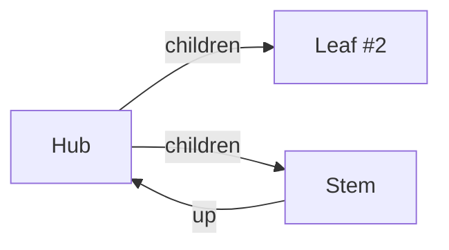

# smut


`smut` is the flagrantly permissive graph database CLI for agents.

It's schemaless, unceremonious, and apt to make a mess. You choose 
whether to clean it up, hide it, or just pretend it was someone else's.

There's no server. `smut` is private, though it can be shared.

`smut` is so easy to use, it's hard to be sure that's a feature.

## Getting smut

```sh
cargo install smut
```

That'll get you one self-contained binary. Now just tell your agent to:

```sh
smut learn
```

They'll love it.

There's also a flake, if that floats your boat:

```nix
inputs = {
  smut = {
    url = "github:davidlee/smut";
    inputs.nixpkgs.follows = "nixpkgs";
  }
};

# packages = [ inputs.smut.packages.${system}.smut ];
```

## Take a peek

An entity is a JSON object. Name an entity with `smut_id`;
leave that out and `smut` draws an eight-char nanoid for you.

`title` and `body` are ordinary fields that `render` treats
as Markdown by convention, and every other field is
data it prints only when asked:

```console
$ smut declare '{"smut_id":"principles","title":"principles","body":"- one\n- two\n- three"}'
{"changes":[{"smut_id":"principles","previous":null,"status":"created"}],"ids":["principles"],"missing":[]}
$ smut render '{"from":"principles"}'
## principles

- one
- two
- three
```

`declare` patches. It changes the fields it names and leaves the rest alone, so
an entity can grow one field at a time:

```console
$ smut declare '{"smut_id":"principles","score":5.6}'
{"changes":[{"smut_id":"principles","previous":{"smut_id":"principles","body":"- one\n- two\n- three","title":"principles"},"status":"updated"}],"ids":["principles"],"missing":[]}
$ smut render '{"from":"principles"}' --show-fields
## principles

- one
- two
- three

- **score:** 5.6
```

An embedded object carrying a `smut_id` is a reference. One declaration can
carry a whole small graph — the entities, their fields and the references
between them — and the reference is stored as the id alone:

```console
$ smut declare '
 {"smut_id":"today",
  "title":"completed today",
  "tasks":[
  {"smut_id":"task-1","status":"DONE","title":"Ship 0.2"},
  {"smut_id":"task-2","status":"DONE","title":"Write the README"}
  ]}
'
{"changes":[{"smut_id":"today","previous":null,"status":"created"},{"smut_id":"task-1","previous":null,"status":"created"},{"smut_id":"task-2","previous":null,"status":"created"}],"ids":["today"],"missing":[]}
$ smut render '{"from":"today","follow":["tasks"]}' --show-fields
## completed today

- **tasks:** [{"smut_id":"task-1"},{"smut_id":"task-2"}]

## Ship 0.2

- **status:** DONE

## Write the README

- **status:** DONE
```

The worked example below takes the same shapes end to end: a filtered read, the
Mermaid request this release refuses, `"DROP"`, a delete, and the dangling
reference the delete leaves behind. `smut learn` prints the rules.

## What it is

`smut` is a single binary. Everything — entities, their fields and
the references between them — lives as JSON under `.smut/` in the directory
you run it in, and reads come back as JSON or as Markdown.

Smut aims very low - which makes it accessible, dirt cheap, and extremely unassuming.

An agent can build you a persistent object graph almost by accident.
Render it to markdown when you want to. Swap in a fresh agent,
or commit it for later, and everything's right there.

## Context warning

The rest of this readme is pure slop, I'm afraid. I'd have deleted it,
but you never know when an agent's going to write tests aserting your
README worked examples compile.

If you got this far, you know everything worth knowing, honestly.

## Worked example

A scratch directory, a store, and the brief's end-to-end example. This is the
transcript of running the release build, command for command: a nested
declaration, the graph walked and rendered, a filtered read, an amend that keeps
the fields it does not name, the Mermaid step 0.2 refuses by name, a `DROP`, a
delete, and a walk that follows the reference the delete left behind. The last
step reports that reference as dangling rather than recreating it.

```console
$ smut declare '[{"smut_id":"smut","title":"Smut","body":"Persist conversational structure.","questions":[{"smut_id":"q-query","type":"question","status":"open","title":"Query design","body":"Keep selection small."}]}]'
{"changes":[{"smut_id":"smut","previous":null,"status":"created"},{"smut_id":"q-query","previous":null,"status":"created"}],"ids":["smut"],"missing":[]}
$ smut get smut q-query
{"dangling":[],"missing":[],"objects":[{"smut_id":"smut","body":"Persist conversational structure.","questions":[{"smut_id":"q-query"}],"title":"Smut"},{"smut_id":"q-query","body":"Keep selection small.","status":"open","title":"Query design","type":"question"}],"truncated":false,"truncation_reasons":[]}
$ smut query '{"from":"smut","follow":["questions"],"select":["title","body"]}'
{"dangling":[],"missing":[],"objects":[{"smut_id":"smut","body":"Persist conversational structure.","title":"Smut"},{"smut_id":"q-query","body":"Keep selection small.","title":"Query design"}],"traversal":{"depths":{"q-query":1,"smut":0},"edges":[{"field":"questions","source":"smut","target":"q-query"}],"frontier":["q-query"]},"truncated":false,"truncation_reasons":[]}
$ smut render '{"from":"smut","follow":["questions"],"select":["title","body"]}'
## Smut

Persist conversational structure.

## Query design

Keep selection small.
$ smut declare '{"smut_id":"q-query","status":"resolved","body":"Use bounded traversal and simple predicates."}'
{"changes":[{"smut_id":"q-query","previous":{"smut_id":"q-query","body":"Keep selection small.","status":"open","title":"Query design","type":"question"},"status":"updated"}],"ids":["q-query"],"missing":[]}
$ smut query '{"where":{"type":"question","status":"resolved"}}'
{"dangling":[],"missing":[],"objects":[{"smut_id":"q-query","body":"Use bounded traversal and simple predicates.","status":"resolved","title":"Query design","type":"question"}],"truncated":false,"truncation_reasons":[]}
$ smut render '{"from":"smut","follow":["questions"]}' --format mermaid
smut: --format mermaid is not supported in this release; planned for 1.0
$ smut declare '{"smut_id":"q-query","status":"DROP"}'
{"changes":[{"smut_id":"q-query","previous":{"smut_id":"q-query","body":"Use bounded traversal and simple predicates.","status":"resolved","title":"Query design","type":"question"},"status":"updated"}],"ids":["q-query"],"missing":[]}
$ smut delete q-query
{"deleted":["q-query"],"missing":[]}
$ smut query '{"from":"smut","follow":["questions"]}'
{"dangling":[{"field":"questions","source":"smut","target":"q-query"}],"missing":[],"objects":[{"smut_id":"smut","body":"Persist conversational structure.","questions":[{"smut_id":"q-query"}],"title":"Smut"}],"traversal":{"depths":{"smut":0},"edges":[],"frontier":[]},"truncated":false,"truncation_reasons":[]}
```

What the transcript shows, in order: one declaration that produced two entities
and made the nested declaration a `smut_id`-only reference; a read of both; a
traversal query that follows `questions` to a depth-1 discovery and reports the
depth, the edge and the frontier behind it; the same selection rendered as
Markdown; an amend that preserved the fields it did not name; a filter that
selects on the amended status; the Mermaid request, refused by name because that
format is 1.0's; a `DROP` that removed exactly one field; a delete, after which
`smut`'s reference to the deleted entity is left dangling rather than cascaded;
and finally the same walk over the reference the delete left behind, reported as
dangling and left alone.

## Querying, quickly

`smut q` takes the same query as a line of words instead of a JSON object: a bare
word is a thing, `field=value` is a filter, and `--word` is structure. The cast
is the worked example's, with two more questions and a decision so each line has
something to find:

```console
$ smut declare -c '[{"smut_id":"smut","title":"Smut","body":"Persist conversational structure.","questions":[{"smut_id":"q-query"}]}]'
{"changes":[{"smut_id":"smut","status":"created"}],"ids":["smut"],"missing":["q-query"]}
$ smut declare -c '[{"smut_id":"q-query","type":"question","status":"open","title":"Query design","body":"Keep selection small."},{"smut_id":"q-limit","type":"question","status":"closed","title":"Does the limit stop the walk?","body":"Discovery is bounded separately."},{"smut_id":"d-escape","type":"decision","title":"JSON stays the complete surface","body":"Grouping and structural operands stay in query."}]'
{"changes":[{"smut_id":"q-query","status":"created"},{"smut_id":"q-limit","status":"created"},{"smut_id":"d-escape","status":"created"}],"ids":["q-query","q-limit","d-escape"],"missing":[]}
$ smut declare -c '[{"smut_id":"q-query","part-of":[{"smut_id":"smut"}]},{"smut_id":"q-limit","part-of":[{"smut_id":"smut"}]}]'
{"changes":[{"smut_id":"q-query","status":"updated"},{"smut_id":"q-limit","status":"updated"}],"ids":["q-query","q-limit"],"missing":[]}
```

The envelope is the one `smut query` returns — `missing`, `dangling`, `truncated`,
`truncation_reasons` — because `q` is a front end and not a second engine. The
line and its JSON twin print the same bytes:

```console
$ smut q status=open --ids
{"dangling":[],"missing":[],"objects":[{"smut_id":"q-query"}],"truncated":false,"truncation_reasons":[]}
$ smut query '{"where":{"status":"open"},"select":["smut_id"]}'
{"dangling":[],"missing":[],"objects":[{"smut_id":"q-query"}],"truncated":false,"truncation_reasons":[]}
```

`~` is a substring test on a string and a member test on an array, and the answer
does not say which ran. `=` with a comma list means one of them:

```console
$ smut q title~design --select smut_id,title
{"dangling":[],"missing":[],"objects":[{"smut_id":"q-query","title":"Query design"}],"truncated":false,"truncation_reasons":[]}
$ smut q type=question,decision --select smut_id,type
{"dangling":[],"missing":[],"objects":[{"smut_id":"d-escape","type":"decision"},{"smut_id":"q-limit","type":"question"},{"smut_id":"q-query","type":"question"}],"truncated":false,"truncation_reasons":[]}
```

The direction is the token you read first, and it is the footgun the guide warns
about. Same root, same field, opposite direction:

```console
$ smut q smut --follow questions --depth 1 --ids
{"dangling":[],"missing":[],"objects":[{"smut_id":"smut"},{"smut_id":"q-query"}],"traversal":{"depths":{"q-query":1,"smut":0},"edges":[{"field":"questions","source":"smut","target":"q-query"},{"field":"part-of","source":"q-query","target":"smut"}],"frontier":["q-query"]},"truncated":false,"truncation_reasons":[]}
$ smut q smut --backlinks questions --depth 1 --ids
{"dangling":[],"missing":[],"objects":[{"smut_id":"smut"}],"traversal":{"depths":{"smut":0},"edges":[],"frontier":[]},"truncated":false,"truncation_reasons":[]}
```

`depths` says how far each returned entity was found, `edges` is the induced edge
set among the returned objects, and `frontier` is what the depth bound left
unexpanded — a boundary, not a truncation.

**Two things it cannot say, and the JSON that can.** A section that showed only
wins would read as a salesman. The short form cannot carry a structural operand or
a cross-field group; both are `smut query`'s, and the first fails *silently*, so
the wall is worth showing:

```console
$ smut q 'questions~{"smut_id":"q-query"}' --ids
{"dangling":[],"missing":[],"objects":[],"truncated":false,"truncation_reasons":[]}
$ smut query '{"where":{"questions":{"$contains":{"smut_id":"q-query"}}},"select":["smut_id","title"]}'
{"dangling":[],"missing":[],"objects":[{"smut_id":"smut","title":"Smut"}],"truncated":false,"truncation_reasons":[]}
$ smut query '{"where":{"$or":[{"type":"question","status":"open"},{"type":"decision"}]},"select":["smut_id","type"]}'
{"dangling":[],"missing":[],"objects":[{"smut_id":"d-escape","type":"decision"},{"smut_id":"q-query","type":"question"}],"truncated":false,"truncation_reasons":[]}
```

The first line exits 0 and returns nothing: an object inside an array is not a JSON
scalar, so the value rule keeps it as text and it matches no array member. The
spelling that works is one line down. `$or`, `$and` and `$not` have no short form
at all — a comma list covers "one of a list on one field", which is the common
case, and everything else stays JSON.

Worth knowing, once each:

- **Same rules.** One store, one lock, one recovery, one envelope, the same exit
  codes; `q` validates before any store exists, exactly as `query` does.
- **Same bytes** for the traversing recipes and `--ids`. For a filtering recipe the
  two spellings agree on the selected set, and ordering is the `order` key's
  business in both.
- **`--depth` needs a direction** and says so — a JSON caller may generate a depth
  it does not use, a human may not. **There is no unlimited `--limit`**: `smut get`
  is the unlimited path.
- **A field name no entity carries answers empty at exit 0**, in both verbs. The
  typo is silent; a filter that matches nothing is a legal way to probe a store.
- The rest of the short surface — `--select`, `--order`, `--limit`, `--has`,
  `--missing`, `--edges`, `--from=ID` — and every refusal it can raise are in
  `smut learn`, which prints all twelve flags and the five token shapes in one
  place.

## Commands

| command | what it does |
| --- | --- |
| `smut declare [JSON] [-c\|--compact]` | record or amend entities; the only command that creates a store |
| `smut get <ID>...` | fetch entities by `smut_id`, in the order given, with no limit |
| `smut delete <ID>...` | remove entities in one batch; incoming references are left untouched |
| `smut query [JSON]` | select entities with a query specification |
| `smut q [TOKEN]...` | the same selection as a line of words: bare roots and `field=value` filters, with `--flags` for everything else |
| `smut render [JSON]` | the same selection, printed as Markdown |
| `smut conventions [NAME] [-f\|--format json]` | list the built-in conventions sets, print one, or print it as a declaration |
| `smut learn` | print the embedded guide |

`declare`, `query` and `render` take one JSON argument or one complete JSON value
on stdin, when the argument is absent or is `-`. With no argument and a terminal
attached you get usage instead of a silent wait. Trailing input after the JSON
value is refused, and so is a duplicate key inside one object.

The specification keys are `from`, `where`, `select`, `order`, `limit`,
`follow`, `backlinks`, `depth`, `budget` and `edges`. `smut q` compiles its
a line of words to this same specification, so both verbs obey one pipeline, one
envelope and one set of exit codes. Absent `from` means every
entity in
`smut_id` order; absent `select` means every field, and `smut_id` is always
returned whatever `select` names; `order` is
`[{"field": NAME, "direction": "asc" | "desc"}]`, sorting missing values last
and breaking ties by `smut_id`; and no `limit` still caps a result at 100 with
`"truncated": true` and a reason. `where` is a predicate over
one entity's top-level fields — `$eq`, `$ne`, `$in`, `$exists` and `$contains`,
ANDed by default, with `$and`, `$or` and `$not` to compose — and it filters the
named roots only, before any traversal. `follow` and `backlinks` take `"*"` on
its own — never as an array element — or an array of top-level field names,
`depth` defaults to 1 (0 is roots only), `budget` defaults to 10000 entity
expansions and is inert without a traversal key, and a supplied traversal key
adds a `traversal` member carrying `depths`, `edges` and `frontier`. `edges: true`
is the way to get that member without asking for a walk: it supplies a traversal
that follows nothing, so it discovers nothing, spends no `budget` and cannot
truncate, and the edge set is derived from the returned objects. `get` is
selection with the ids you name, no limit and no truncation.

`render` flags, each with a one-letter spelling because they are typed often:
`-f|--format markdown` (the only format this release writes;
`mermaid` is refused by name, because it is 1.0's), `-t|--heading-field`
(default `title`), `-l|--heading-level 1-6` (default 2), `-s|--show-fields`,
`-i|--show-ids`.

Exit codes: `0` success, including reported missing ids and a truncated result;
`1` no store, or a store that could not be read or written; `2` invalid input or
usage. JSON goes to stdout, diagnostics go to stderr, and a failure never prints
a success envelope.

## Conventions

`smut conventions` prints advice, not a schema. It needs no store, it reads no
store, it validates nothing and it selects nothing for you: it is one shipped set
of prose about how entities and references are shaped, versioned with the build
that prints it. With no argument it lists the sets; with a name it prints that
set; with `--format json` it prints the set as one declaration, which you can
pipe straight into `smut declare -` —
`smut conventions hygiene --format json | smut declare -` creates a single entity
with a fixed `smut_id` (`conventions-hygiene`) that a later install updates in
place rather than duplicating. The seeded `body` is advice and is replaced on
re-install; fields you add to that entity survive.

## Traversal: what it costs and what it reports

**What `budget` does not bound.** `budget` counts entity expansions — how many
entities the walk is allowed to open. It is not a bound on total work. Every hop
that looks backwards scans the store for incoming references, and a query with no
`from` or `where` scans the whole store before it has any roots at all. A small
`budget` beside a `backlinks` request therefore does not mean a small amount of
work, and `smut` makes no total-work claim.

**What a traversal reports, and what it does not.** A query that supplies
`follow` or `backlinks` — even as an empty array — carries a `traversal` member
beside the 0.1 envelope:

- `depths` maps each **returned** id to its minimum discovery depth, roots at 0.
- `edges` is the induced subgraph of the returned entities: `{source, field,
  target}` triples, deduplicated, in result order, oriented as stored. An edge
  appears when both endpoints are returned, even if neither was expanded, even
  if the field was never named as a traversal label, and even if `select` hid
  it. References to ids not in the store are not edges.
- `frontier` is what discovery reached and did not expand, in discovery order. It
  is walk-scoped: `limit` does not cut it, though a depth or budget boundary
  does.

The envelope also says why a result is incomplete: `truncated` with
`truncation_reasons`, which is `result_limit` when ordered rows were cut and
`traversal_budget` when the walk declined a permitted expansion. A depth boundary
is selection, not truncation, so a finite `depth` never sets either. `dangling`
reports the traversal's references to ids that are not in the store — one triple
per reference, deduplicated, in encounter order, and not cut to the returned
sources — and nothing is ever recreated to fill the gap. A non-traversing query
carries exactly 0.1's five keys, so nothing above appears where nothing was
walked.

### The edge set without a traversal

A question about the graph does not have to be a walk. `edges: true` supplies a
traversal that follows nothing, so the reply carries the edge set and nothing was
expanded:

```console
$ smut declare '[{"smut_id":"hub","title":"Hub","children":[{"smut_id":"leaf","title":"Leaf #2"},{"smut_id":"stem","title":"Stem","up":{"smut_id":"hub"}}]}]'
{"changes":[{"smut_id":"hub","previous":null,"status":"created"},{"smut_id":"leaf","previous":null,"status":"created"},{"smut_id":"stem","previous":null,"status":"created"}],"ids":["hub"],"missing":[]}
$ smut query '{"where":{"title":{"$in":["Hub","Stem"]}},"edges":true,"select":["title"]}'
{"dangling":[],"missing":[],"objects":[{"smut_id":"hub","title":"Hub"},{"smut_id":"stem","title":"Stem"}],"traversal":{"depths":{"hub":0,"stem":0},"edges":[{"field":"children","source":"hub","target":"stem"},{"field":"up","source":"stem","target":"hub"}],"frontier":[]},"truncated":false,"truncation_reasons":[]}
$ smut query '{"edges":true,"select":["smut_id","title"]}'
{"dangling":[],"missing":[],"objects":[{"smut_id":"hub","title":"Hub"},{"smut_id":"leaf","title":"Leaf #2"},{"smut_id":"stem","title":"Stem"}],"traversal":{"depths":{"hub":0,"leaf":0,"stem":0},"edges":[{"field":"children","source":"hub","target":"leaf"},{"field":"children","source":"hub","target":"stem"},{"field":"up","source":"stem","target":"hub"}],"frontier":[]},"truncated":false,"truncation_reasons":[]}
```

Two things in the second reply. The edges point opposite ways because that is how
the store holds them — `hub` lists `stem` as a child and `stem` names `hub` as its
container — so the edge set reports what is stored and infers nothing from which
direction anyone walked. And nothing was walked: every `depths` entry is `0`,
`frontier` is empty, no `budget` was spent. The edges are derived from the
returned objects, not from the walk, which is why they survive a `select` that
hides the reference field.

That is the whole external-rendering story — the reply already carries
`{source, field, target}` triples, oriented and deduplicated — so the exporter is
one `jq` program, and it is spelled out here rather than described. Two things in
it are not obvious, and both are comments rather than traps:

```jq
# Symbols are generated, never ids: an id is opaque data that may hold any
# character, so pasting one into the graph would hand a payload the syntax.
#
# Two escape functions, not one, because mermaid has two label contexts. `#`
# starts an entity code, so a stored `#` must become `#35;` *before* `"` becomes
# `#quot;` — otherwise the codes this emits get escaped again. And `|` delimits
# an edge label while being ordinary text inside a quoted node label.
def esc:     gsub("#"; "#35;") | gsub("\""; "#quot;");
def escpipe: esc | gsub("\\|"; "#124;");

.objects as $objs
| ($objs | to_entries | map({key: .value.smut_id, value: "n\(.key)"}) | from_entries) as $sym
| [ "flowchart LR",
    ( $objs[] | "  \($sym[.smut_id])[\"\((.title // .smut_id) | esc)\"]" ),
    ( .traversal.edges[] | "  \($sym[.source]) -->|\(.field | escpipe)| \($sym[.target])" ) ]
| .[]
```

It needs `objects` and `edges` from the **same** envelope, because `edges` carries
ids and a diagram wants titles — that is why the third query above keeps `title`
in `select`. Narrower, and every edge survives while every node degrades to an
id: connectivity comes from the stored entity, presentation from the projection.
Run over that store, the program draws:



What no program can recover from `edges` alone: the picture is cut by `limit`
along with `objects` and says nothing about it, and a dangling reference is not
an edge, so a broken link looks like no link. Both are readable in the envelope,
and a drawing has no room for either — which is the reason the renderer inside
`smut` has to keep saying it.

## Sharp edges

- **`smut_id` is structural at every depth; `id` is yours.** An embedded object
  carrying a `smut_id` is a reference: it is hoisted into an entity of its own
  and replaced by `{"smut_id": "..."}` in the container, so a payload cannot
  store a field named `smut_id` verbatim. The rename to `smut_id` is what frees
  `id` — it is ordinary data at any depth, zero or many across the tree, stored,
  queried and projected like any other field.
- **`"DROP"` is a top-level field sentinel and cannot be assigned as a value.**
  `{"smut_id":"x","status":"DROP"}` removes `status`; inside an embedded value
  or an array, the string `"DROP"` is ordinary data. `null` is an ordinary stored
  value everywhere.
- **A missing store is exit 1, not an empty store.** `get`, `delete` and `query`
  never create one, and a declaration with nothing to write
  (`smut declare '{}'`) does not either.
- **A store another `smut` wrote is refused, not migrated.** The store format is
  versioned; a store of an older format is exit 1, and there is no upgrade path
  and no repair path — the loader refuses what it cannot trust rather than
  reconstructing it.
- **`1` and `1.0` are distinct values that compare equal.** Structural equality
  says they differ, so a batch giving one entity's field both is refused as a
  conflicting declaration; ordering says they tie, and the tie breaks by
  `smut_id`.
- **`where` filters roots only, and `$` is reserved inside a predicate.** A
  traversal may still return an entity that fails the predicate, and a root the
  predicate rejects is omitted rather than reported missing. A field whose name
  begins with `$` cannot be filtered, and an object carrying `$` keys is an
  operator object unless you compare it whole with `$eq`. A missing field fails
  every operator except `$exists`, which counts a stored `null` as present.
- **An unrecognised key or operator is reported as unknown**, without a promise:
  the 0.2 query surface is complete, so a typo is a typo rather than a key due in
  a later release. `--format` is the only surface still promising one (Mermaid,
  in 1.0).
- **`--` reaches an opaque id.** Ids are opaque, case-sensitive strings and may
  begin with a hyphen, so `smut get -- -weird-id` names that id. Without `--` it
  is a usage error.
- **Bodies may absorb each other, but never the completeness notice.** A body is
  rendered verbatim, so a stored body ending in an unclosed HTML comment or an
  unclosed fence hides whatever follows it. The notice for a truncated or
  incomplete result is the document's first block, so nothing stored can swallow
  it.

## What smut promises

The store is written through a journal. Its bytes, its states and its fsync
obligations are described in
[the store format document](https://github.com/davidlee/smut/blob/main/docs/store-format.md), and
this is the guarantee that protocol licenses, quoted in full:

> Under the documented filesystem and fsync assumptions, cooperating commands
> observe whole batches. Before application begins, the commit decision is made
> durable, together with every staged byte that decision commits to.
> Interrupted committed batches are replayed before any command serves store
> state. Failure before acknowledgement may leave the outcome uncertain;
> successfully acknowledged batches are durable.

That is **atomic visibility through locking and recovery**, on top of non-atomic
physical publication. It is deliberately not claimed that a group of renames is
atomic on any real filesystem, and no claim is made about what a power loss
leaves on the disk beyond the documented fsync assumptions.

The uncertainty the guarantee names is commit-before-acknowledgement. A command
can die after its batch was committed and before its success response reached
you, so an interrupted command's effect is *unknown* rather than undone. An
acknowledged batch — exit 0, response printed — is committed and durable.

## Portability

Linux is the acceptance platform. The store is plain files and directories and
nothing in it is Linux-specific by intent, but nothing else is tested.

The store lock is `flock`, which is advisory: it excludes cooperating `smut`
commands and nothing else. A process that does not take the lock — an editor, a
shell redirect, a stray script — is not excluded, and nothing is promised to it.
Editing `.smut/` by hand is not supported.

## Learn

`smut learn` prints the embedded guide: the conventions, the response shapes, the
workflows, and the rules in the order you hit them. It needs no store, and it is
version-matched to the build that prints it.

## License

`smut` is free software under the GNU General Public License, version 3
(GPL-3.0-only): you may redistribute it and/or modify it under those terms, and
it comes with no warranty. See
[the licence text](https://github.com/davidlee/smut/blob/main/LICENSE) for the
full text.
